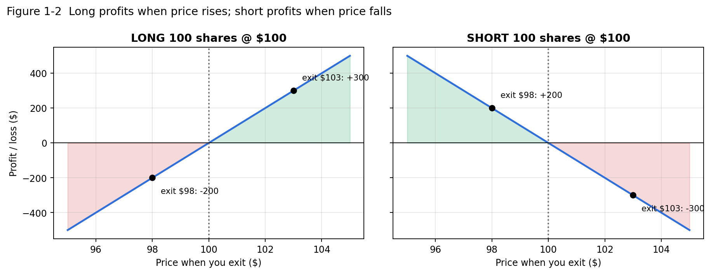

# PART I — MARKET BASICS (LEVEL 1) {.unnumbered .part}

# How Day Trading Actually Works

Before looking at a single indicator, you need to know what actually happens when you click "Buy". This chapter covers the mechanics. Everything later in the manual is built on these definitions.

## Stocks and shares

::: {.def custom-style="Box Definition"}
**DEFINITION — Stock / Share**

*Plain English:* A **stock** is part-ownership of a company. A **share** is one unit of that ownership. Owning 100 shares of AAPL means you own 100 units of Apple Inc.

*Technical:* A share is an equity security that trades on an exchange (NYSE, Nasdaq) or an alternative trading venue. Its price is set by the most recent trades between buyers and sellers.

*How I use it:* You trade shares of S&P 500 companies priced between $10 and $500 **[RULE]**.
:::

**Day trading** means opening *and* closing a position within the same trading day, so that you hold nothing overnight. Your v1 system is intraday only. Every position is intended to close before the 4:00 PM ET close.

## The quote: bid, ask, spread and last

At any moment there are two prices for a stock, not one.

| Term | Plain English | Technical |
|---|---|---|
| **Bid** | The highest price someone is currently willing to **pay**. | Best (highest) buy limit order displayed. You **sell** at the bid if you sell immediately. |
| **Ask** (offer) | The lowest price someone is currently willing to **sell** at. | Best (lowest) sell limit order displayed. You **buy** at the ask if you buy immediately. |
| **Spread** | The gap between them. | Spread = Ask − Bid. |
| **Last** (last price) | The price of the most recent trade. | Last executed print. It can be at the bid, at the ask or between them. |
| **NBBO** | National Best Bid and Offer. | The best bid and best ask across all US exchanges. |

**Numerical example.** A stock shows Bid $100.00 × 300, Ask $100.03 × 500, Last $100.02.

* Spread = $100.03 − $100.00 = **$0.03** (3 cents).
* If you buy with a market order right now, you probably pay about **$100.03** (the ask), not $100.02 (the last trade).
* If you then immediately sell with a market order, you get about **$100.00** (the bid).
* Round-trip cost from the spread alone: $0.03 per share. For 500 shares that is **$15**, before any price movement.
* "× 300" and "× 500" are the share quantities displayed at those prices (the *size*).

::: {.why custom-style="Box Why"}
**WHY IT MATTERS**

Your v1 stop distances can be as small as $0.20–$0.50. A $0.03 spread is then 6–15% of your entire risk budget per share, paid before the trade has done anything. Wide spreads quietly destroy small-stop strategies. This is one reason the v1 universe is liquid S&P 500 stocks with more than 1M shares of average daily volume.
:::

::: {.mistake custom-style="Box Mistake"}
**COMMON MISTAKE**

Treating "Last" as the price you will get. In a fast market, the last trade may be several cents away from where you can actually buy or sell right now.
:::

## Trading sessions

| Session | Time (ET) | Notes |
|---|---|---|
| Pre-market | 04:00 – 09:30 | Thinner liquidity, wider spreads. Brokers usually accept only limit orders here. Alpaca: extended-hours orders must be **limit** with TIF `day` or `gtc` **[ALP]**. |
| **Regular market hours** | **09:30 – 16:00** | Highest liquidity. **v1 trades only in this session [RULE].** |
| After-hours (post-market) | 16:00 – 20:00 | Thin liquidity. Earnings releases often happen here. |
| Alpaca overnight | 20:00 – 04:00 (Sun–Fri) | Alpaca documents an overnight session [ALP]. Not used in v1. |

TrendSpider uses the same pre-market (04:00–09:30) and post-market (16:00–20:00) definitions for extended-hours alerts **[TS]**.

**"Market closed"** in a platform means the regular session is not running. Depending on settings, quotes may still move in extended hours. A market order placed while the market is closed is either rejected or queued for the next open, which is broker-dependent. Do not do it in v1.

## Order types

An **order** is an instruction to your broker. The order type controls *price certainty* versus *fill certainty*. You can rarely have both.

| Order | Plain English | Fill certainty | Price certainty | Typical use in v1 |
|---|---|---|---|---|
| **Market** | "Fill me now at whatever the best available price is." | High | Low (slippage) | Emergency exits; possibly entries in very liquid names. |
| **Limit** | "Fill me only at this price or better." | Low (may never fill) | High | Controlled entries; profit targets. |
| **Stop** (stop-market) | "When price reaches X, send a market order." | High once triggered | Low (can gap through) | **Stop-losses**, and **breakout entries** (buy-stop above the signal high). |
| **Stop-limit** | "When price reaches X, send a *limit* order at Y." | Lower (can skip past Y) | Higher | Breakout entries with a price cap. Not available in the TrendSpider Trading widget per its documentation **[TS]**. |
| **Bracket** | Entry plus an attached stop-loss *and* take-profit. When one exit fills, the other cancels. | — | — | The ideal v1 structure. Alpaca supports it via API **[ALP]**. |
| **OCO** | "One-Cancels-Other": two exit orders, and if one fills the other is cancelled. | — | — | Adding stop and target to an *existing* position. Alpaca supports it **[ALP]**. |

### Worked examples of each order type (LONG side)

Stock XYZ: Bid $50.00 / Ask $50.02.

1. **Market buy 100.** Fills immediately at about $50.02, or worse if the ask is thin and moves up.
2. **Limit buy 100 @ $49.95.** Fills only if a seller accepts $49.95 or less. If price rises, you never fill.
3. **Buy-stop 100 @ $50.30.** Nothing happens until price trades at $50.30. Then a market order is sent, which might fill at $50.31–$50.35 in a fast move. This is how "buy the break of the signal candle high" works.
4. **Buy stop-limit 100, stop $50.30, limit $50.40.** At $50.30 a limit order to buy at up to $50.40 is sent. If price jumps straight to $50.45, you do **not** fill. That protects you from a terrible price, but you miss the trade.
5. **Sell-stop 100 @ $49.70 (stop-loss on a long).** If price falls to $49.70, a market sell is sent. In a gap or flash drop the fill could be $49.60 or worse.

### Worked examples (SHORT side)

1. **Sell-short stop @ $49.70.** Triggers a market short sale when price falls to $49.70. This is the mirror of a breakout entry, used for a breakdown entry.
2. **Buy-stop @ $50.30 (stop-loss on a short).** If price rises to $50.30, a market buy is sent to *cover* (close) the short.

::: {.mistake custom-style="Box Mistake"}
**COMMON MISTAKE**

Thinking a stop-loss guarantees the stop price. A stop guarantees only that an order is *triggered* at that price. The fill can be worse. That difference is **slippage**.
:::

## Liquidity, volume, volatility and slippage

| Term | Plain English | Technical | Why you care |
|---|---|---|---|
| **Liquidity** | How easily you can trade without moving the price. | Depth of resting orders near the NBBO, combined with tight spreads. | Liquid stocks fill near your intended price. |
| **Volume** | How many shares traded. | Shares exchanged during a period (per candle, per day). | High volume generally means more participation and liquidity. |
| **Average volume** | Typical volume. | Mean of daily volume over N days (v1: 20-day). | v1 requires a daily volume 20-period moving average above 1,000,000 shares **[RULE]**. |
| **Volatility** | How much price moves. | Dispersion of returns, often measured by ATR or standard deviation. | Sets how wide stops must be and how fast P/L swings. |
| **Slippage** | Getting a worse price than you planned. | Fill price − intended price (long), or intended − fill (short). | Turns a planned −1R loss into −1.1R or −1.3R. |

**Slippage example.** You plan to buy 500 shares at $100.21. Your stop-entry triggers and fills at $100.26. Slippage = $0.05 × 500 = **$25**. If your planned risk was $250, slippage has already used 10% of it.

## LONG and SHORT, explained carefully

This is the most important idea in Part I.

::: {.def custom-style="Box Definition"}
**DEFINITION — LONG**

*Plain English:* You **buy first and sell later**. You make money if price **rises**.

*Technical:* A long position is a positive share quantity. P/L = (Exit price − Entry price) × Shares.
:::

::: {.def custom-style="Box Definition"}
**DEFINITION — SHORT**

*Plain English:* You **sell first and buy back later**. You borrow shares you don't own, sell them now, and later buy them back (**cover**) to return them. You make money if price **falls**.

*Technical:* A short position is a negative share quantity. P/L = (Entry price − Exit price) × Shares. The broker must be able to *locate* shares to borrow (Reg SHO), and the account must be margin-enabled.
:::

{width=95%}

### Long examples

| # | Action | Entry | Exit | Shares | P/L calculation | Result |
|---|---|---|---|---|---|---|
| L1 | Buy, price rises | $100.00 | $103.00 | 100 | (103 − 100) × 100 | **+$300** |
| L2 | Buy, price falls | $100.00 | $98.00 | 100 | (98 − 100) × 100 | **−$200** |
| L3 | Buy, small move | $45.20 | $45.65 | 500 | (45.65 − 45.20) × 500 | **+$225** |

### Short examples

| # | Action | Entry (sell) | Exit (buy to cover) | Shares | P/L calculation | Result |
|---|---|---|---|---|---|---|
| S1 | Short, price falls | $100.00 | $97.00 | 100 | (100 − 97) × 100 | **+$300** |
| S2 | Short, price rises | $100.00 | $102.00 | 100 | (100 − 102) × 100 | **−$200** |
| S3 | Short, small move | $45.20 | $44.80 | 500 | (45.20 − 44.80) × 500 | **+$200** |

### Short-selling step by step (S1)

1. You **sell short** 100 shares at $100. Your broker borrows 100 shares for you and sells them. Your account shows **−100 shares** and you receive $10,000 in proceeds, which are restricted as collateral.
2. Price falls to $97.
3. You **buy to cover** 100 shares at $97, paying $9,700. The shares are returned to the lender.
4. Profit = $10,000 − $9,700 = **$300**, before borrow fees and commissions.

::: {.why custom-style="Box Why"}
**WHY IT MATTERS — the asymmetry of short risk**

A long position can lose at most 100% (price falls to $0). A short position has **theoretically unlimited** loss, because price can keep rising. That is why a hard stop is *non-negotiable* on shorts, and why gap risk (Chapter 18) matters more for shorts. In v1 every position closes intraday, which removes overnight gap risk. It does not remove halts or news spikes.
:::

### Regulatory realities of shorting [REG]

| Rule | What it says (simplified) | Effect on you |
|---|---|---|
| **Locate (Reg SHO)** | Brokers must have reasonable grounds to believe shares can be borrowed before a short sale. | Hard-to-borrow stocks may be un-shortable. S&P 500 names are usually easy to borrow, but not always. |
| **Short Sale Restriction / SSR (Rule 201)** | If a stock falls **10% or more** from the prior day's close, short sales are restricted to prices **above** the national best bid for the rest of that day and the next day. | Your short-entry stop orders may not execute normally on SSR stocks. **v1 recommendation: skip shorts on SSR-flagged stocks [REC].** |
| **Margin** | Shorting requires a margin account. | Alpaca documents shorting support in both paper and live accounts **[ALP]**. Its buying-power check for an opening short uses the higher of the limit price or 3% above the ask, × quantity **[ALP]**. |

## Account terms

| Term | Plain English | Technical / Example |
|---|---|---|
| **Cash** | Money not invested. | Can be negative on margin accounts after buying more than your cash. |
| **Equity / Portfolio value** | What the account is worth right now. | Cash + market value of longs − market value of shorts. Paper account starts near $100,000. |
| **Buying power** | How much stock you are *allowed* to buy right now. | Depends on equity and margin rules. It can be 2× (overnight) or more (intraday) of equity in margin accounts. **Buying power is a limit, not a target.** |
| **Position** | What you currently hold in one symbol. | +300 AAPL (long) or −200 MSFT (short). |
| **Realized P/L** | Profit/loss that is locked in because the position is closed. | Bought 100 at $50, sold 100 at $51 → realized +$100. |
| **Unrealized P/L** | Paper gain/loss on positions still open. | Bought 100 at $50, price now $50.40 → unrealized +$40. It can disappear. |

**Worked equity example.** Start: cash $100,000. Buy 400 shares at $50 (cost $20,000). Cash = $80,000; position value = $20,000; equity = $100,000. Price rises to $50.75: position value = $20,300; unrealized P/L = +$300; equity = $100,300. Sell all at $50.75: cash = $100,300; realized P/L = +$300; unrealized = $0.

### The PDT rule — an important 2026 change [REG]

Until mid-2026, FINRA's "Pattern Day Trader" rule required **$25,000 minimum equity** in margin accounts that made 4 or more day trades in 5 business days. **The SEC approved FINRA's amendments to Rule 4210 in April 2026, effective June 4, 2026.** They remove the PDT designation and the $25,000 minimum, and replace them with an **intraday margin standard** for all margin customers. Brokers may phase this in until October 20, 2027. Alpaca announced implementation on June 4, 2026 and deprecation of its PDT API fields **[ALP]**.

::: {.warn custom-style="Box Warn"}
**VERIFY**

Alpaca's "User Protection" page still described the old PDT protection when checked on 2026-10-28, while its changelog and forum describe the change. Confirm in your Alpaca dashboard whether your **paper** account still applies any day-trade-count protection. This matters mostly when you later trade a live account below $25,000.
:::

## Anatomy of a trade

| Term | Plain English | Example (LONG) | Example (SHORT) |
|---|---|---|---|
| **Entry** | Price at which you open. | Buy at $100.25 | Sell short at $99.75 |
| **Stop-loss** | Pre-set price where you admit you are wrong and exit. | Sell-stop at $99.75 | Buy-stop at $100.25 |
| **Take-profit (target)** | Pre-set price where you take the gain. | Sell limit at $101.25 | Buy limit at $98.75 |
| **Exit** | Price at which you close, for any reason. | — | — |
| **Risk/share** | What you lose per share if stopped. | 100.25 − 99.75 = $0.50 | 100.25 − 99.75 = $0.50 |
| **Reward/share** | What you gain per share at target. | 101.25 − 100.25 = $1.00 | 99.75 − 98.75 = $1.00 |
| **Risk/reward (R:R)** | Reward ÷ risk. | 1.00 / 0.50 = **2:1 (2R)** | **2:1 (2R)** |

## Market structure vocabulary

| Term | Plain English | How it looks | How v1 uses it |
|---|---|---|---|
| **Support** | A price zone where buying has repeatedly stopped declines. | Multiple lows near the same level. | A short entry *just above* major support is poor: little room to fall. |
| **Resistance** | A zone where selling has repeatedly stopped advances. | Multiple highs near the same level. | A long entry *just below* major resistance is poor. |
| **Breakout** | Price moves *above* resistance with conviction. | Strong candle closing above a level, ideally on high volume. | LONG entry = break of the signal candle high (a micro-breakout). |
| **Breakdown** | Price moves *below* support. | Strong candle closing below a level. | SHORT entry = break of the signal candle low. |
| **Pullback** | A temporary move against the trend. | Uptrend dips toward VWAP/EMA20, then resumes. | Often a better-priced entry than chasing. |
| **Retest** | Price returns to a broken level to "test" it from the other side. | Old resistance acts as new support. | Confirmation that a breakout is real. |
| **Trend** | Persistent direction. | Higher highs and higher lows (up); lower highs and lower lows (down). | EMA9 vs EMA20, VWAP and the 15m EMA20 define trend in v1. |
| **Consolidation** | Sideways, range-bound trading. | Overlapping candles, flat EMAs. | Signals fail more often here. |
| **Momentum** | Speed and persistence of a move. | Large candles in one direction, rising RSI. | v1 is a momentum system. |
| **Reversal** | Trend changes direction. | Lower high after an uptrend, VWAP lost, EMAs cross. | Reversals trigger v1 Exit C (trend failure). |
| **Gap** | Open far from the prior close, with an empty space on the chart. | Daily open 3% above yesterday's close. | Large gaps distort early indicators; see the "extreme gap" checklist item. |

::: {.mistake custom-style="Box Mistake"}
**COMMON MISTAKE**

Treating support and resistance as exact lines. They are **zones**. A level at $150.00 may "hold" at $149.85 or $150.20.
:::
