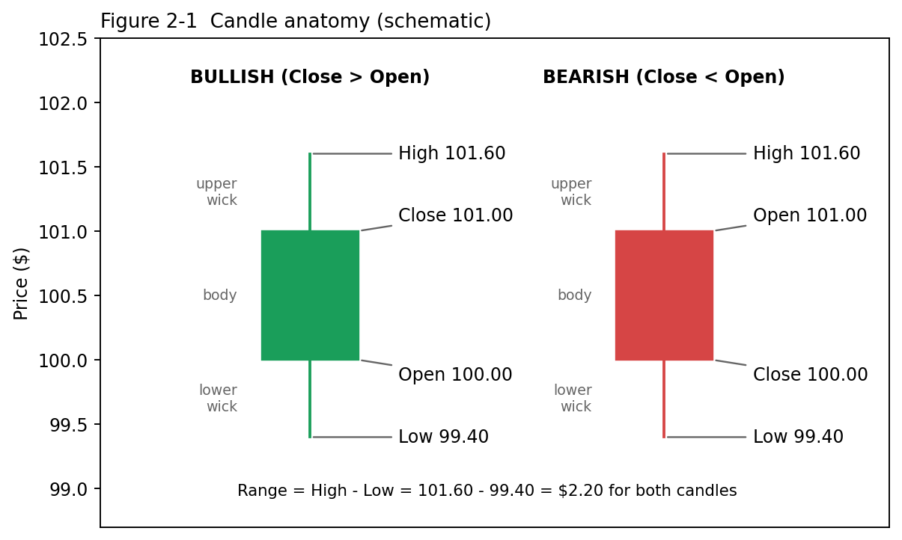
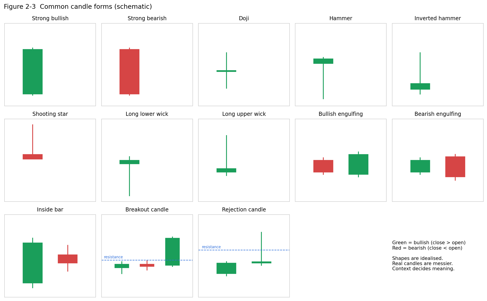

# PART II — CANDLES (LEVEL 2) {.unnumbered .part}

# Candlesticks — Complete Beginner Training

::: {.rule custom-style="Box Rule"}
**THE ONE RULE OF THIS CHAPTER**

**Never trade a candlestick pattern in isolation. Context matters.** In v1, a candle is meaningful only inside the full checklist: VWAP, EMA alignment, RSI, RVOL and 15-minute confirmation.
:::

## The four prices: Open, High, Low, Close (OHLC)

*Plain English:* A candle summarises everything that happened during one fixed slice of time.

| Price | Meaning |
|---|---|
| **Open (O)** | First traded price of the period. |
| **High (H)** | Highest traded price of the period. |
| **Low (L)** | Lowest traded price of the period. |
| **Close (C)** | Last traded price of the period. For a candle still forming, the "close" is the *current* price and keeps changing until the period ends. |

{width=85%}

| Part | Definition | Formula |
|---|---|---|
| **Body** | Rectangle between Open and Close. | Body = \|Close − Open\| |
| **Upper wick** (shadow) | Line above the body. | Upper wick = High − max(Open, Close) |
| **Lower wick** | Line below the body. | Lower wick = min(Open, Close) − Low |
| **Range** | Full height. | Range = High − Low |
| **Bullish candle** | Close > Open (usually green/hollow). | — |
| **Bearish candle** | Close < Open (usually red/filled). | — |
| **Body %** | How much of the range is body. | Body ÷ Range |

**Numerical example.** O $100.00, H $101.60, L $99.40, C $101.00.

* Body = 101.00 − 100.00 = **$1.00** (bullish)
* Upper wick = 101.60 − 101.00 = **$0.60**
* Lower wick = 100.00 − 99.40 = **$0.60**
* Range = 101.60 − 99.40 = **$2.20**
* Body % = 1.00 / 2.20 = **45%**

## Candle timeframe

A candle's timeframe is the length of time it summarises.

| Timeframe | One candle = | Candles in a regular session (6.5 h) | Typical use |
|---|---|---|---|
| **1-minute** | 60 seconds of trading | 390 | Precision timing. Very noisy for beginners. |
| **5-minute** | 5 minutes | 78 | **v1 entry chart.** |
| **15-minute** | 15 minutes | 26 | **v1 confirmation chart.** |
| **Daily** | One full trading session | 1 per day | Universe filters (price, average volume, daily % change). |

A 5-minute candle labelled 10:00 covers **10:00:00–10:04:59** in most charting conventions (time labels mark the *start* of the bar). The 10:00 candle closes at 10:05.

::: {.warn custom-style="Box Warn"}
**VERIFY — bar timestamp convention**

Most platforms, including TrendSpider by common convention, label bars by their *open* time. Confirm on your chart by hovering the first regular-session 5m bar: it should read 9:30, and its close should appear at 9:35.
:::

## What "1 candle ago" means

"N candles ago" counts **bars on the condition's own timeframe**, not minutes.

| Timeframe of the condition | "Current candle" | "1 candle ago" | "3 candles ago" |
|---|---|---|---|
| 5-minute | The 5m bar in progress (or just closed — see below) | The previous 5-minute bar | 15 minutes earlier |
| 15-minute | Current 15m bar | Previous 15-minute bar | 45 minutes earlier |
| Daily | Today's session | **Yesterday's** session (previous trading day) | 3 trading days ago; weekends and holidays are skipped |

TrendSpider's scripting uses offsets for this. A condition with no offset reads the latest value, and its help gives the example of comparing today's close with the prior day's close using a one-candle offset **[TS]**. In indicator settings, **Offset 0 = current candle, −1 = previous candle, −2 = the one before** **[TS]**.

### "Current" depends on scanner/alert settings

* **Market Scanner with Current Candle ON** treats the still-forming candle *as if it were closed* **[TS]**. With it OFF, the scan uses the most recent **closed** candle **[TS]**.
* **Multi-Factor Alerts** are checked when the candle of the **smallest timeframe in the alert closes** (e.g., every 5 minutes for a 5m alert) **[TS]**. Your 5m conditions are therefore evaluated on a *completed* 5m candle. That completed candle is your **signal candle**.

::: {.mistake custom-style="Box Mistake"}
**COMMON MISTAKE**

Reading "Close > Open" on a *forming* candle and treating it as final. A candle that is green at 10:02 can close red at 10:05.
:::

## Candle forms

{width=100%}

For each form below: structure → what buyers/sellers did → LONG reading → SHORT reading → when meaningful → when meaningless.

### Strong bullish candle

| Aspect | Description |
|---|---|
| Structure | Large green body (≥ ~70% of range), small wicks, closes near the high. |
| Buyers/sellers | Buyers controlled the whole period and were still pushing at the close. |
| LONG | Supportive, especially when it closes above VWAP and EMA9 > EMA20. Often a v1 signal candle. |
| SHORT | Warning: do not short into it. |
| Meaningful when | It follows a pullback to VWAP/EMA20, on elevated RVOL, aligned with the 15m. |
| Meaningless/dangerous when | It is 3–5× the average candle size after an extended run (exhaustion, poor stop placement), or a news spike. |

### Strong bearish candle

The exact mirror: large red body, closes near the low. Sellers controlled the period. It supports a SHORT when below VWAP with EMA9 < EMA20, and warns against a LONG. It is dangerous to short when enormous and far below VWAP (snap-back risk).

### Doji

| Aspect | Description |
|---|---|
| Structure | Open ≈ Close (tiny body), wicks on one or both sides. |
| Buyers/sellers | Balance. Neither side won the period. |
| LONG / SHORT | Indecision. Neither a buy nor a sell signal by itself. |
| Meaningful when | It appears after a strong run *at* a key level, and the *next* candle breaks decisively. |
| Meaningless when | It appears mid-range in quiet consolidation, which is common and carries no information. |
| v1 note | A doji cannot satisfy "Close > Open" (or "<") meaningfully, so v1 alerts will rarely fire on one. |

### Hammer

| Aspect | Description |
|---|---|
| Structure | Small body near the top; **lower wick ≥ 2× body**; little upper wick. Colour matters less. |
| Buyers/sellers | Sellers pushed price down hard, buyers pushed it all the way back. |
| LONG | Potential bullish reversal **after a decline into support**. |
| SHORT | Warning for shorts: buyers defended the lows. |
| Meaningful | At support, VWAP or prior day low, after a downtrend, with volume. |
| Meaningless | In the middle of nowhere, or in a strong downtrend without confirmation. |

### Inverted hammer

Small body near the **bottom**, long **upper** wick, after a *decline*. Buyers tried to push up and failed by the close, but the attempt itself can signal a shift. It needs next-candle confirmation. It is weaker than a hammer.

### Shooting star

The same shape as an inverted hammer, but **after an advance**: long upper wick, small body near the low. Buyers pushed up and sellers rejected the high. It is a potential bearish reversal at resistance. It warns LONGs and supports SHORT setups *with* confirmation.

### Long lower wick / long upper wick

| Candle | Message | LONG reading | SHORT reading |
|---|---|---|---|
| Long lower wick | Lower prices were **rejected**. | Supportive near support/VWAP. | Caution: buyers are present. |
| Long upper wick | Higher prices were **rejected**. | Caution: sellers are present. | Supportive near resistance/VWAP. |

**Numerical example (long upper wick).** O $50.10, H $51.00, L $50.00, C $50.20. Upper wick = 51.00 − 50.20 = $0.80 out of a $1.00 range (80%). Price touched $51 and was sold off.

### Bullish engulfing

| Aspect | Description |
|---|---|
| Structure | Red candle followed by a green candle whose **body fully covers** the prior body. |
| Meaning | Buyers overwhelmed the prior period's sellers. |
| LONG | Potential reversal or continuation trigger at support/VWAP. |
| SHORT | Warning against shorting. |
| Meaningful | After a pullback in an uptrend, on above-average volume. |
| Meaningless | Small candles in chop. |

### Bearish engulfing

The mirror: a green candle followed by a red candle whose body covers it. Sellers overwhelmed buyers. It supports SHORT at resistance or below VWAP and warns LONGs.

### Inside bar

The second candle's high and low are **both inside** the prior candle's range. It signals contraction or a pause. A break *out* of the inside bar's range, in the direction of the trend, can be a trigger. Inside bars are common, so they are meaningful only at decision points.

### Breakout candle

A candle that **closes beyond** a defined level (resistance, prior high, consolidation range), ideally with large volume. LONG: confirmation of a breakout. SHORT: the breakdown version closes below support. It is meaningless if it closes back inside the range (a "failed breakout") or if the move is a single huge bar after the trend has already extended.

### Rejection candle

A candle that **trades through a level but closes back on the original side**, leaving a long wick through the level. For example, price pokes above resistance at $150, hits $150.40 and closes at $149.90. It shows that the level held. It warns against a LONG breakout and supports a SHORT. The mirror at support works the other way.

## Context checklist for any candle

Ask these five questions before giving any candle meaning:

1. **Where is it?** At support/resistance/VWAP, or in the middle of a range?
2. **What came before?** A trend, a pullback or a chop?
3. **How large is it** relative to recent candles and to ATR?
4. **What was volume/RVOL?** High volume gives more weight.
5. **What does the higher timeframe (15m) say?**

::: {.mistake custom-style="Box Mistake"}
**COMMON MISTAKE**

Memorising pattern names and trading every one. Studies of candlestick patterns in isolation show weak and inconsistent edges. Their value comes from **location and confirmation**, which is exactly what your v1 indicator stack supplies.
:::
