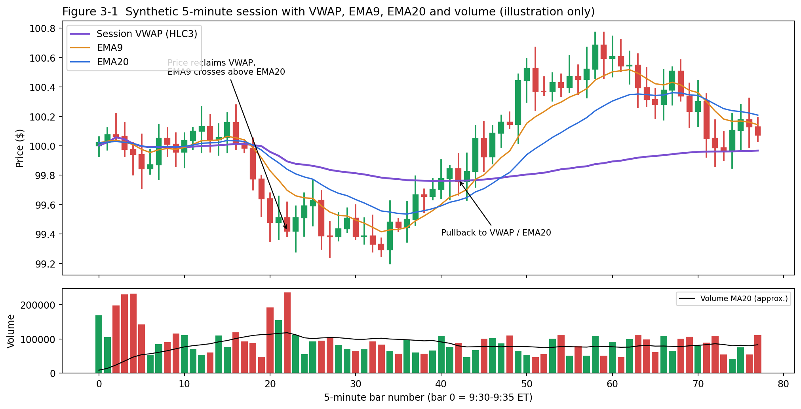
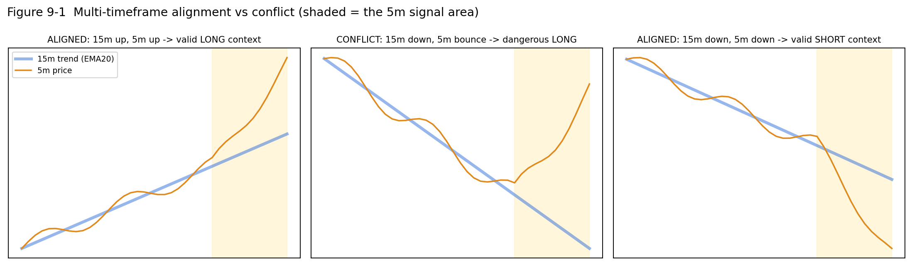

# PART III — INDICATORS (LEVEL 3) {.unnumbered .part}

::: {.rule custom-style="Box Rule"}
**WHICH INDICATORS ARE IN v1?**

| Indicator | Status | Where it is used |
|---|---|---|
| VWAP | **v1 core** | Scanner, alert, exit C |
| EMA9, EMA20 (5m) | **v1 core** | Scanner, alert, exit C |
| EMA20 (15m) | **v1 core** | Scanner, alert (higher-timeframe confirmation) |
| RSI14 | **v1 core** | Scanner (>55 / <45), alert, ranking (55–70 / 30–45) |
| Relative Volume (RVOL20) | **v1 core** | Scanner (>2.0), alert (>1.5) |
| Volume / Volume MA20 (daily) | **v1 core** | Universe filter (>1M shares) |
| ATR | v1 *reference only* | Sanity-checks stop size and "too extended". Not a hard rule. |
| SMA, MACD, Bollinger, ADX, Stochastic, RS, ADR, pivots | **Optional / future** | Not part of v1 decisions |
:::

# VWAP — Volume Weighted Average Price

## Plain English

VWAP is the **average price paid for every share traded so far today**, where each price is weighted by how many shares traded there. It answers: *"On average, is today's buyer in profit or in loss right now?"*

## Technical definition [IND]

For each candle *i* since the session start (standard VWAP resets at the session open):

* **Typical price** (when Price Source = HLC3): TPᵢ = (Highᵢ + Lowᵢ + Closeᵢ) ÷ 3
* **VWAP** = Σ(TPᵢ × Volumeᵢ) ÷ Σ Volumeᵢ

where Σ means "sum over all candles from the session start to now", and Volumeᵢ is the shares traded in candle *i*.

## Why volume weighting matters — numerical example

| Bar | High | Low | Close | TP = (H+L+C)/3 | Volume | TP × Volume |
|---|---|---|---|---|---|---|
| 1 | 100.50 | 99.50 | 100.20 | 100.0667 | 10,000 | 1,000,667 |
| 2 | 101.00 | 100.10 | 100.90 | 100.6667 | 30,000 | 3,020,000 |
| 3 | 101.20 | 100.60 | 100.70 | 100.8333 | 5,000 | 504,167 |
| **Σ** | | | | | **45,000** | **4,524,833** |

* VWAP = 4,524,833 ÷ 45,000 = **$100.55**
* A simple average of the three typical prices = **$100.52**
* VWAP is pulled toward bar 2 because **two-thirds of all shares traded there**. That is where most participants have their cost basis.

{width=100%}

## How traders read VWAP

| Situation | Plain English | LONG implication | SHORT implication |
|---|---|---|---|
| **Price above VWAP** | The average buyer today is in profit, so buyers are in control. | Favourable; required by v1 | Unfavourable; v1 shorts not allowed |
| **Price below VWAP** | The average buyer is underwater, so sellers are in control. | Unfavourable | Favourable; required by v1 |
| **VWAP as support** | In uptrends, pullbacks often stall at VWAP. | Pullback-to-VWAP entries | — |
| **VWAP as resistance** | In downtrends, rallies often stall at VWAP. | — | Rally-to-VWAP entries |
| **VWAP reclaim** | Price was below, closes back above. | Possible new long setup | Short thesis invalidated |
| **VWAP rejection** | Price pokes through VWAP but closes back on the original side. | At VWAP from below: bearish | From above: bullish |
| **Distance from VWAP** | How stretched price is. | Far above = overextended, snap-back risk | Far below = overextended |

## Standard vs Anchored VWAP

| Type | Starts summing from | Use |
|---|---|---|
| **Standard (session) VWAP** | The session open (9:30 ET, or 4:00 ET if extended hours are included). | Intraday trend reference. Institutional benchmark. |
| **Anchored VWAP (AVWAP)** | A point *you choose* (earnings day, swing low, gap day). | "Average cost since event X." TrendSpider has a separate Anchored VWAP indicator **[TS]**. |

## TrendSpider VWAP parameters — what `VWAP(14, 0, HLC3)` means

TrendSpider lists three VWAP inputs **[TS]**:

| Parameter | Your value | TrendSpider's documented meaning |
|---|---|---|
| **Length** | 14 | "Number of periods used in the calculation." |
| **Offset** | 0 | Which candle the value is read from: 0 = current candle, −1 = previous, −2 = the one before. |
| **Price Source** | HLC3 | The candle data point used (open, high, low, close, or a combination). HLC3 = (High + Low + Close) ÷ 3, the classic VWAP "typical price". |

So `VWAP(14, 0, HLC3)` reads as "VWAP, length 14, current candle, typical price".

::: {.warn custom-style="Box Warn"}
**VERIFY — what "Length 14" does to VWAP in TrendSpider**

A *standard session VWAP has no lookback length*: it sums from the session open. TrendSpider's VWAP help page lists Length as "number of periods" but does **not** say whether VWAP (a) resets each session and ignores Length, (b) is a *rolling* 14-bar volume-weighted average (on a 5m chart that is the last ~70 minutes), or (c) something else. These give **materially different lines**, especially after 11:00 ET.

**Test (10 minutes, do it once):**

1. On a 5m AAPL chart, add your VWAP(14, 0, HLC3).
2. Add a second VWAP with a very different Length (e.g., 50) and a **Anchored VWAP** anchored at today's 9:30 candle.
3. At 13:00 ET compare the three values.
   * If all three match → Length is ignored; your VWAP is a true session VWAP.
   * If the 14 and 50 versions differ → Length creates a *rolling* VWAP. Decide deliberately which you want (see Chapter 22, v2 item 1).
4. Record the result in the Change Log.

**Whatever the result: the chart, the scanner and the alerts must use identical VWAP settings.** Otherwise a chart that "looks above VWAP" may not match the alert's VWAP (see Troubleshooting).
:::

## How v1 uses VWAP

::: {.rule custom-style="Box Rule"}
**MY v1 RULE — VWAP**

* LONG scanner and alert: **5m Close > VWAP**.
* SHORT scanner and alert: **5m Close < VWAP**.
* Exit C (trend failure): a LONG is exited on a **5m close below VWAP**, and a SHORT on a **5m close above VWAP**.
* Ranking: prefer price *above but not far above* VWAP (LONG); *below but not far below* (SHORT).
:::

::: {.mistake custom-style="Box Mistake"}
**COMMON MISTAKE**

Buying simply because price is above VWAP. In a strong trend price may be above VWAP all day, including at the exact top. VWAP is a **filter** (which side to trade), not a **trigger** (when to trade).
:::

**When NOT to rely on VWAP:** in the first 5–15 minutes (very few bars, so VWAP is unstable); on low-volume days; across multiple days (session VWAP resets); on daily or higher timeframes.

# Moving Averages — SMA and EMA

## Simple Moving Average (SMA)

*Plain English:* The plain average of the last N closing prices. It smooths out noise.

*Formula [IND]:* SMA(N) = (C₁ + C₂ + … + C_N) ÷ N, where C₁…C_N are the last N closes.

*Example:* Last five 5m closes: 10, 11, 12, 13, 14 → SMA5 = 60 ÷ 5 = **12**. The next close is 15. Drop 10, add 15 → 11, 12, 13, 14, 15 → SMA5 = **13**.

| Common SMA | On a daily chart | On a 5m chart |
|---|---|---|
| SMA20 | ~1 month of trading | 100 minutes |
| SMA50 | ~2.5 months | ~4 hours |
| SMA200 | ~10 months; the classic long-term trend line | ~2.5 sessions |

**Changing the timeframe changes the meaning.** "SMA20" is 20 *candles*, so its time span depends entirely on the timeframe.

## Exponential Moving Average (EMA)

*Plain English:* A moving average that gives **more weight to recent candles**, so it reacts faster than an SMA.

*Formula [IND]:*

* α (smoothing factor) = 2 ÷ (N + 1)
* EMA_today = α × Close_today + (1 − α) × EMA_yesterday

| EMA | α | Weight on newest candle |
|---|---|---|
| EMA9 | 2/10 = 0.200 | 20.0% |
| EMA20 | 2/21 ≈ 0.095 | 9.5% |

*Example:* Previous EMA9 = $100.00. The new 5m candle closes at $101.00.

* EMA9 = 0.2 × 101.00 + 0.8 × 100.00 = **$100.20**
* EMA20 (previous $100.00) = 0.0952 × 101.00 + 0.9048 × 100.00 = **$100.10**

EMA9 moved twice as far as EMA20 in response to the same candle. That is why EMA9 "leads".

### How much time does EMA9 or EMA20 "cover" on a 5-minute chart?

* EMA9 ≈ 9 × 5 min = **~45 minutes** of bars.
* EMA20 ≈ 20 × 5 min = **~100 minutes**.

This is only an *intuitive* description. An EMA never fully forgets old data: every past candle keeps a shrinking weight. A useful fact: for any EMA(N), roughly **86–87% of the total weight** lies in the most recent N candles, since 1 − (1 − α)^N ≈ 1 − e⁻² ≈ 0.865. So "EMA9 ≈ the last 45 minutes" is a good mental model, as long as you remember the older bars still count a little.

## EMA alignment vs EMA crossover

| Concept | Meaning | v1 usage |
|---|---|---|
| **Alignment** (state) | EMA9 is *currently* above (or below) EMA20. | **v1 uses alignment** in the scanner and alert. |
| **Crossover** (event) | EMA9 *crosses* EMA20 on this candle. | v1 uses the crossover only as **Exit C** (trend failure). |
| **Slope** | Is the EMA rising or falling? | Discretionary check. Prefer both EMAs sloping in the trade direction. |
| **Separation** | Gap between EMA9 and EMA20. | Ranking. Clear separation = established trend. Very wide = possibly overextended. |
| **Compression** | EMAs nearly touching and flat. | Chop. Signals are less reliable. |

**EMA9 > EMA20** → the short-term average is above the medium-term average, so recent prices are higher (bullish bias).
**EMA9 < EMA20** → bearish bias.

**Separation example:** EMA9 $100.40, EMA20 $100.10. Separation = $0.30 = 0.30 ÷ 100.10 ≈ **0.30%** of price. Compare across candidates in percentage terms, not dollars.

## SMA vs EMA

| | SMA | EMA |
|---|---|---|
| Weighting | Equal | Recent-heavy |
| Speed | Slower | Faster |
| False signals | Fewer, but later | More, but earlier |
| v1 | Not used | **Used (9, 20)** |

::: {.mistake custom-style="Box Mistake"}
**COMMON MISTAKE**

Treating every EMA crossover as a trade. In sideways markets EMAs cross back and forth constantly ("whipsaw"). v1 requires several confirming conditions for exactly this reason.
:::

# RSI — Relative Strength Index

## Plain English

RSI measures **how strongly price has been rising versus falling** over recent candles, on a 0–100 scale. High RSI = recent gains dominated. Low RSI = recent losses dominated.

## Technical definition [IND] (Wilder's RSI)

1. For each candle: Gain = max(Close − PrevClose, 0); Loss = max(PrevClose − Close, 0).
2. AvgGain and AvgLoss = Wilder-smoothed averages over N candles (N = 14 for RSI14).
3. RS = AvgGain ÷ AvgLoss.
4. **RSI = 100 − 100 ÷ (1 + RS)**.

"14" means the averages cover 14 candles. On a 5m chart that is 70 minutes of bars, with Wilder smoothing keeping some memory of older bars.

| AvgGain | AvgLoss | RS | RSI |
|---|---|---|---|
| 0.30 | 0.15 | 2.00 | 100 − 100/3 = **66.7** |
| 0.20 | 0.20 | 1.00 | **50.0** |
| 0.10 | 0.20 | 0.50 | 100 − 100/1.5 = **33.3** |
| — | — | 1.22 | **55** (your LONG threshold) |
| — | — | 0.82 | **45** (your SHORT threshold) |

## 70/30, "overbought" and "oversold" — and why RSI > 70 is NOT a sell signal

| Reading | Textbook label | What it really means |
|---|---|---|
| > 70 | "Overbought" | Strong upward momentum. In trends, RSI can stay above 70 for hours. |
| < 30 | "Oversold" | Strong downward momentum. It can stay there. |
| 50 | Neutral | Gains and losses balanced. |

There are two interpretations:

* **Momentum interpretation (v1 uses this):** RSI above 55 = upside momentum confirmed; below 45 = downside momentum.
* **Reversal interpretation:** extreme RSI (> 80 / < 20) = move may be exhausted and a snap-back is likely. v1 uses this only as a *caution* in ranking.

::: {.why custom-style="Box Why"}
**WHY RSI 75 IS NOT AUTOMATICALLY A SHORT**

RSI 75 says buyers have dominated recently. Shorting it is betting that the strongest buyers of the day are about to quit, with no evidence other than "it went up a lot". In v1, a SHORT requires price *below* VWAP, EMA9 < EMA20 and RSI < 45. An RSI-75 stock fails every one of those.
:::

## Divergence

*Bearish divergence:* price makes a **higher high** but RSI makes a **lower high**, so momentum is fading. *Bullish divergence:* price makes a **lower low**, RSI a **higher low**. Divergences are **warnings, not triggers**, and are not part of v1.

## How v1 uses RSI

::: {.rule custom-style="Box Rule"}
**MY v1 RULE — RSI14 (5m)**

| | Hard filter (scanner/alert) | Preferred zone (ranking) | Caution zone |
|---|---|---|---|
| LONG | RSI > 55 | **55–70** | > 75–80: exhaustion risk |
| SHORT | RSI < 45 | **30–45** | < 20–25: exhaustion / snap-back risk |
:::

**When NOT to rely on RSI:** in the first ~15 minutes of the session (very few bars since the open, and the overnight gap distorts it), in illiquid names, and as a stand-alone signal.

# Volume and Relative Volume (RVOL)

## Raw volume vs average volume

| Term | Meaning | Example |
|---|---|---|
| **Volume** (per candle) | Shares traded during that candle. | The 10:00–10:05 candle traded 250,000 shares. |
| **Average volume** | Mean of volume over N candles. | 20-day average daily volume = 4.2M shares. |
| **Volume MA20 (Daily)** | The 20-period simple moving average of *daily* volume. | v1 filter: **> 1,000,000 shares** **[RULE]**. |

**Why 1M+ daily volume?** Liquidity. A stock trading 1M+ shares a day typically has tight spreads and enough depth that a few-hundred-share order barely moves it. For the S&P 500 this filter removes very few names, but it guards the system if you later expand the universe.

## Relative Volume (RVOL)

*Plain English:* "Is this candle busier than normal?" RVOL compares current volume with its own recent average.

*Technical (TrendSpider's Relative Volume indicator) [TS]:* RVOL = Volume ÷ MA(Volume, Length). The inputs are:

| Parameter | Your value | Meaning [TS] |
|---|---|---|
| **Length** | 20 | Number of periods in the volume average. |
| **MA Type** | SMA | Averaging method. Options include SMA, EMA and HullMA. |
| **Base** | 1 | The benchmark/reference line. Base 1 = "average volume". The help example: a base of 1.1 marks volume 10% above average. |

| RVOL | Meaning |
|---|---|
| 0.5 | Half the usual volume: quiet, low conviction. |
| 1.0 | Normal. |
| 1.5 | 50% above normal. **v1 alert threshold.** |
| 2.0 | Double normal: strong participation. **v1 scanner threshold.** |
| 3.0+ | Unusual activity: news, a breakout, or opening/closing distortion. |

**Example:** the 5m candle traded 300,000 shares; the 20-candle average is 100,000 → RVOL = **3.0**.

## Why high RVOL matters, and why extreme RVOL can be dangerous

* **High RVOL** = many participants agree on the move. Breakouts on high volume fail less often than breakouts on low volume [IND].
* **Extreme RVOL (e.g., 8–15+)** often means news, a halt-resume, an index rebalance, or a climax. Spreads widen and candles get enormous, so stop distances explode. The "trend" may be a single-candle spike that reverses.

::: {.warn custom-style="Box Warn"}
**VERIFY — opening and closing distortion in a bar-based RVOL**

TrendSpider documents RVOL as volume relative to its moving average. It does **not** document a "time-of-day" adjustment. If RVOL is bar-to-recent-bars (likely), then:

* **At 9:30–9:45**, the first 5m bars are compared with the previous 20 bars. Those are mostly *yesterday afternoon*, or thin pre-market bars if Extended Hours is on. Opening bars are naturally 3–10× busier, so **RVOL is inflated at the open for almost every stock**.
* **At 15:50–16:00**, closing-auction flows inflate volume again. RVOL of 12 at the close is normal and meaningless for v1.
* **After hours**, a single block print against thin bars can create RVOL in the tens.

This is one reason v1 says *observe only from 9:30 to 9:45*, and why the v1.1 entry window opens at 09:45 and closes at 15:30 ET. Check on your chart by comparing the RVOL readings of the 9:30 bar on several quiet stocks.
:::

## Volume vs RVOL

| | Volume | RVOL |
|---|---|---|
| Units | Shares | Ratio (no units) |
| Comparable across stocks? | No (AAPL trades far more than most) | **Yes**: 2.0 means "twice its own normal" for any stock |
| v1 use | Daily MA20 > 1M (liquidity) | 5m RVOL > 2.0 (scanner), > 1.5 (alert) |

# ATR — Average True Range

## Plain English

ATR measures **how much a stock typically moves per candle**, ignoring direction. It measures volatility, not trend.

## Technical definition [IND]

* **True Range (TR)** = the largest of:
  1. High − Low
  2. |High − Previous Close|
  3. |Low − Previous Close|
* **ATR(14)** = Wilder-smoothed average of TR over 14 candles.

The second and third terms capture **gaps**: if a candle opens far from the prior close, that move counts.

**TR example:** Previous close $50.00. Candle H $50.80, L $50.10.

* H − L = 0.70; |H − PC| = 0.80; |L − PC| = 0.10 → **TR = $0.80**. The gap up counts.

## Why a fixed $0.50 stop does not make sense for every stock

| Stock | 5m ATR | A $0.50 stop equals | Interpretation |
|---|---|---|---|
| A ($40 stock) | $0.08 | 6.3 ATR | Absurdly wide. You give back far too much. |
| B ($150 stock) | $0.45 | 1.1 ATR | Reasonable. |
| C ($480 stock) | $1.60 | 0.3 ATR | Noise will stop you out almost immediately. |

Volatility-adjusted stops keep the "meaning" of a stop consistent across stocks.

## ATR multiples, position sizing and "do not chase"

* **ATR stop:** Stop = Entry − k × ATR (LONG) or Entry + k × ATR (SHORT). k is typically 1–2 on intraday charts [IND].
* **ATR and size:** because risk/share rises with ATR, shares fall automatically when you size by risk (Chapter 18). Volatile stocks get smaller positions.
* **ATR and chasing:** if price is already more than **0.25 ATR** beyond your planned entry, the setup is chased: a hard rule in v1.1 (Chapter 16). If the signal candle's range is more than ~2× ATR, the candle is "abnormally large" (Chapter 21).

::: {.rule custom-style="Box Rule"}
**MY v1.1 RULE — ATR sets the minimum stop and the chase limit**

* **Minimum stop distance:** R = MAX(structural risk, **1.0 × ATR(14)** on the 5m chart). The stop is the signal-candle low/high unless that is closer than 1 ATR (Chapter 17).
* **Chase limit:** more than **0.25 × ATR** past the entry = DO NOT CHASE.
* **Sanity checks:** "candle too large" (> ~2 ATR), "too extended" (> ~2.5 ATR from VWAP). The Opportunity Ranker also measures location in ATRs.
:::

# Secondary Indicators — Quick Reference (NOT part of v1)

| Indicator | Plain English | Formula sketch | Typical use | Caution |
|---|---|---|---|---|
| **MACD (12,26,9)** | Momentum from the gap between two EMAs. | MACD = EMA12 − EMA26; Signal = EMA9(MACD); Histogram = MACD − Signal. | Momentum shifts, crossovers. | Lagging; overlaps heavily with EMA9/20. |
| **Bollinger Bands (20,2)** | Volatility envelope. | Middle = SMA20; Bands = SMA20 ± 2 × std. dev. | Squeeze → expansion; extension measure. | Touching a band is not a signal by itself. |
| **ADX (14)** | Trend *strength* (not direction). | Derived from +DI/−DI smoothing; 0–100. | ADX > 25 = trending; < 20 = chop. | Lagging; direction comes from +DI/−DI. |
| **Stochastic (14,3,3)** | Where the close sits in the recent range. | %K = (C − LowestLow) ÷ (HighestHigh − LowestLow) × 100. | Overbought/oversold in ranges. | Pins at extremes in trends. |
| **Relative Strength (RS)** | Stock performance *vs a benchmark* (e.g., SPY). | RS = Price_stock ÷ Price_SPY (or % change difference). | Leaders vs laggards. | **Not the same as RSI.** |
| **ADR (Average Daily Range)** | Typical daily high-to-low range. | Mean of (High − Low) over N days, often as % of price. | How much room is left today. | Ignores gaps (ATR includes them). |
| **Support/Resistance** | Zones where price reversed before. | Swing highs/lows, prior day H/L, round numbers. | Targets, obstacles. | Zones, not lines. |
| **Pivot points (classic)** | Formula levels from the prior day. | P = (H + L + C) ÷ 3; R1 = 2P − L; S1 = 2P − H. | Intraday reference levels. | Self-fulfilling at best. |

**RSI vs Relative Strength:** RSI compares a stock *with its own past*. Relative Strength compares a stock *with another instrument*. A stock can have RSI 65 and still be weaker than SPY.

# Multi-Timeframe Analysis

## Why a 1-minute chart is noisy for a beginner

On a 1m chart, a single large order, a spread flicker or a news headline produces a "signal". Indicators flip constantly, and you face many more decisions per hour, each with less information. The 5m chart filters much of that noise while still giving intraday timing.

## Why v1 uses 5m for entries and 15m for confirmation

| Timeframe | Role | Question it answers |
|---|---|---|
| **Daily** | Universe/context | Is the stock liquid, in my price band, and moving ≥ 1% today in my direction? |
| **15-minute** | **Confirmation (higher timeframe)** | Is the bigger intraday trend on my side? (15m Close > EMA20 for LONG.) |
| **5-minute** | **Entry/timing** | Is there a setup *right now*, and where exactly is my entry and stop? |

**"Higher-timeframe confirmation"** means requiring the larger timeframe to agree with your trade direction before acting on a smaller-timeframe signal. One 15m candle contains three 5m candles (e.g., 9:30, 9:35 and 9:40 make up the 9:30 15m candle). An EMA20 on 15m spans ~300 minutes, roughly the whole morning. It is approximately comparable to (but not identical to) an EMA60 on the 5m chart.

{width=100%}

## Alignment and conflict

| 15m | 5m | Interpretation | v1 action |
|---|---|---|---|
| Up (Close > EMA20) | Up setup | **Aligned.** You trade with the tide. | LONG allowed |
| Down | Down setup | **Aligned.** | SHORT allowed |
| Down | Up setup | **Conflict.** The 5m bounce is likely a pullback inside a 15m downtrend, and sellers wait above. | No LONG (fails the alert) |
| Up | Down setup | **Conflict.** Likely a dip in an uptrend. | No SHORT |

::: {.why custom-style="Box Why"}
**WHY "5m BULLISH BUT 15m BEARISH" IS DANGEROUS**

A 5m rally inside a 15m downtrend often runs straight into the 15m EMA20 or VWAP from below, exactly where higher-timeframe sellers re-enter. Your 2R target sits above a ceiling, while your stop sits in a falling trend.
:::

::: {.warn custom-style="Box Warn"}
**VERIFY — how a 15m condition is evaluated inside a 5m alert**

TrendSpider checks a Multi-Factor Alert when the smallest-timeframe candle closes (here: every 5 minutes) **[TS]**. Its documentation notes that a larger-timeframe condition uses the last calculated data point, and **can become untrue when that larger candle closes**, which can make an alert look like it "misfired" **[TS]**. In practice, at 10:05 the 15m condition may be reading the *still-forming* 10:00–10:15 candle. Always re-check the 15m chart yourself when the alert fires.
:::

::: {.rule custom-style="Box Rule"}
**MY v1.1 RULE — Confirm on the last COMPLETED 15m candle**

The 15m confirmation is a **hard rule** and uses the last fully completed regular-session 15m candle at the alert time: 10:07 → 09:45–10:00 · 10:18 → 10:00–10:15 · 14:52 → 14:30–14:45 · 15:29 → 15:00–15:15. Never the forming candle and never a later one. Details in Chapter 13.
:::
