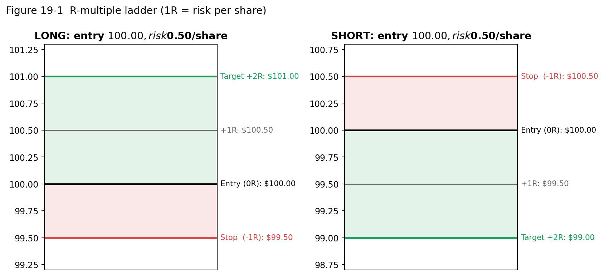
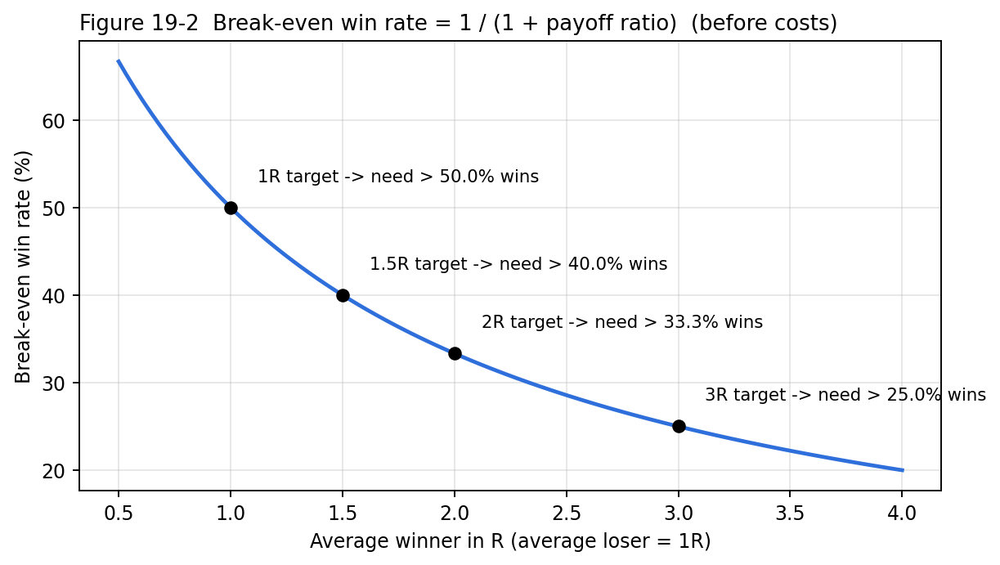

# Risk Management and Position Sizing

> This is the most important chapter in the manual. You cannot control whether a trade wins. You can always control how much it loses.

## Inputs vs outputs

::: {.rule custom-style="Box Rule"}
**MY v1 RULE — Risk per trade**

**Maximum intended loss per trade = 0.25% of current portfolio equity.**
At $100,000 → **$250**.
:::

The key mental shift:

| | Beginner thinking | Professional thinking |
|---|---|---|
| **Input** (you choose) | "I'll buy 500 shares." | "I will lose at most **$250** if wrong." |
| **Output** (calculated) | "My loss will be… whatever happens." | "Therefore I can buy **N shares**." |

**Share quantity is an OUTPUT. Maximum loss is an INPUT.**

## The formulas (v1.1)

| Quantity | LONG | SHORT |
|---|---|---|
| Dollar risk ($R, a maximum) | Equity × 0.25% | Equity × 0.25% |
| Buffer B | MAX($0.01, 0.02% × High) | MAX($0.01, 0.02% × Low) |
| Entry E | High + B | Low − B |
| Risk per share **R** | **MAX(E − Low, 1 × ATR)** | **MAX(High − E, 1 × ATR)** |
| Stop | E − R | E + R |
| 2R target | **E + 2R** | **E − 2R** |
| Shares by risk | floor($R ÷ R) | same |
| Shares by cap | floor($20,000 ÷ E) | same |
| **Position size** | **MIN(shares by risk, shares by cap)** | same |
| Planned loss | Shares × R | same |
| Position value | Shares × E | same |

"floor" means **round down** to a whole share. Rounding up would risk slightly *more* than your limit. Prices are rounded to the cent; R is rounded *up* to the cent when ATR controls (Chapter 17).

## The investment cap ($20,000 per ticker)

Risk-based sizing alone can create **huge positions** when the stop is tight. Example: a $200 stock with a $0.20 stop → 1,250 shares = **$250,000 notional**, 2.5× your equity. A single halt or news gap through your stop could cost many multiples of $250.

::: {.rule custom-style="Box Rule"}
**MY v1.1 RULE — Investment cap**

* **Maximum investment per ticker = $20,000** (position value = shares × entry).
* **Shares = the smaller of** floor($R ÷ R) **and** floor($20,000 ÷ E).
* At most **4 positions** (open + pending), and at most **$80,000** allocated in total (20% of the $100,000 account is a liquidity reserve). The Opportunity Ranker enforces the portfolio limits (Chapter 38).
* When the cap binds, your *actual* risk is below $250. That is acceptable: the $250 is a **maximum**, not a target.

*Replaces the v1.0 recommendation of 50% of equity per position (Change Log, v1.1).*
:::

**How often does the cap bind?** Shares by risk ≤ shares by cap when E ≤ 80 × R (at $250 risk). A $100 stock needs R ≥ $1.25 before risk, not the cap, sets the size. For most S&P 500 names at typical 5-minute stops, **the $20,000 cap decides the size** and the planned loss is well under $250.

## Worked examples

All examples use $100,000 equity (unless stated), 0.25% risk and the $20,000 cap. Every number matches the Trade Calculator. Read each one slowly.

### Example 1 — LONG, high-priced stock, cap binds

* Equity $100,000 → $R = **$250**; cap **$20,000**.
* Signal candle: High $230.40, Low $229.90. ATR $0.45.
* B = MAX(0.01, 0.0002 × 230.40 = 0.04608) → **$0.05**. E = **$230.45**.
* SR = 230.45 − 229.90 = $0.55; 1 × ATR = $0.45 → R = **$0.55** (structure).
* Stop = 230.45 − 0.55 = **$229.90**. Target = 230.45 + 1.10 = **$231.55**.
* Shares by risk = floor(250 ÷ 0.55) = **454**. Shares by cap = floor(20,000 ÷ 230.45) = floor(86.79) = **86**.
* **Final: 86 shares** (cap binds). Position $19,818.70. Planned loss = 86 × 0.55 = **$47.30**. Potential profit $94.60.

### Example 2 — LONG, mid-priced stock

* Signal: High $45.80, Low $45.35, ATR $0.30. B = **$0.01** (0.02% = 0.00916 < minimum). E = **$45.81**.
* SR = 0.46 > ATR 0.30 → R = **$0.46**. Stop **$45.35**. Target = 45.81 + 0.92 = **$46.73**.
* Shares by risk = floor(250 ÷ 0.46) = 543. Shares by cap = floor(20,000 ÷ 45.81) = **436**.
* **Final: 436 shares** (cap binds). Position $19,973.16. Planned loss = 436 × 0.46 = **$200.56**.

### Example 3 — SHORT, cap binds

* Signal: High $88.85, Low $88.10, ATR $0.60. B = MAX(0.01, 0.01762) → **$0.02**. E = 88.10 − 0.02 = **$88.08**.
* SR = High − E = 88.85 − 88.08 = **$0.77** > ATR → R = $0.77. Stop **$88.85**. Target = 88.08 − 1.54 = **$86.54**.
* Shares by risk = floor(250 ÷ 0.77) = 324. Shares by cap = floor(20,000 ÷ 88.08) = **227**.
* **Final: 227 shares.** Position $19,994.16. Planned loss **$174.79**.

### Example 4 — LONG, enormous signal candle (math works, checklist says skip)

* $300 stock. Signal: High $302.50, Low $299.00, ATR $1.20. B = **$0.06**. E = **$302.56**.
* R = SR = **$3.56**. Stop $299.00. Target = 302.56 + 7.12 = **$309.68**.
* Shares = MIN(floor(250 ÷ 3.56) = 70, floor(20,000 ÷ 302.56) = 66) = **66**. Planned loss $234.96.
* But the candle range of $3.50 ≈ **2.9 ATR**: an *abnormally large* candle. Reaching +$7.12 needs ~6 more ATRs of movement. **Skip** (Do-Not-Take list).

### Example 5 — SHORT, low-priced stock, ATR controls, risk binds

* Signal: High $24.85, Low $24.60, ATR $0.35. B = **$0.01**. E = **$24.59**.
* SR = 24.85 − 24.59 = $0.26 < ATR $0.35 → R = **$0.35** (ATR). Stop = 24.59 + 0.35 = **$24.94** (above the signal high). Target = 24.59 − 0.70 = **$23.89**.
* Shares = MIN(floor(250 ÷ 0.35) = **714**, floor(20,000 ÷ 24.59) = 813) = **714** (risk binds). Planned loss **$249.90**. Position $17,557.26.

### Example 6 — LONG, tiny candle: the ATR minimum protects you

* $120 stock. Signal: High $120.08, Low $119.98 (range $0.10), ATR $0.40. B = **$0.02**. E = **$120.10**.
* SR = $0.12, far inside normal noise. R = MAX(0.12, 0.40) = **$0.40**. Stop **$119.70**. Target **$120.90**.
* Shares = MIN(625, floor(20,000 ÷ 120.10) = **166**) = **166**. Planned loss **$66.40**.
* Under v1.0 the stop would have been $119.98, only $0.12 away: a $0.02 spread would have been 17% of the risk. v1.1 sizes the trade on the realistic $0.40.

### Example 7 — Equity has fallen (risk shrinks automatically)

* Equity now $98,600 → $R = 0.25% × 98,600 = **$246.50**.
* LONG: High $18.24, Low $17.80, ATR $0.30. B $0.01 → E **$18.25**. R = SR = **$0.45**. Stop $17.80. Target **$19.15**.
* Shares = MIN(floor(246.50 ÷ 0.45) = floor(547.8) = **547**, floor(20,000 ÷ 18.25) = 1,095) = **547**. Planned loss **$246.15**. Position $9,982.75.

### Example 8 — Equity has grown; the cap does not

* Equity $103,200 → $R = **$258**. The cap stays **$20,000**: it is a fixed dollar amount per ticker, not a percentage of equity.
* SHORT: High $153.10, Low $152.43, ATR $0.50. B = **$0.03** → E = **$152.40**. R = SR = 153.10 − 152.40 = **$0.70**. Target = 152.40 − 1.40 = **$151.00**.
* Shares = MIN(floor(258 ÷ 0.70) = 368, floor(20,000 ÷ 152.40) = **131**) = **131**. Planned loss **$91.70**.

### Example 9 — The effect of slippage

* Take Example 7 (547 shares, planned loss $246.15).
* Entry actually fills at $18.30 (+$0.05 slippage); stop actually fills at $17.76 (−$0.04).
* Actual loss/share = 18.30 − 17.76 = $0.54 → loss = 547 × 0.54 = **$295.38 ≈ −1.20R**.
* **Lesson:** stops are not guaranteed prices. A −1R plan often becomes −1.1R to −1.3R in fast markets.
* *Optional (REC):* size on (R + expected slippage). With $0.03 expected slippage: floor(246.50 ÷ 0.48) = 513 shares.

### Example 10 — Large price, unrealistic target

* $480 stock. Signal: High $484.00, Low $478.50, ATR $1.80. B = **$0.10** → E **$484.10**.
* R = SR = **$5.60** → Stop $478.50; Target = 484.10 + 11.20 = **$495.30**.
* Shares = MIN(floor(250 ÷ 5.60) = 44, floor(20,000 ÷ 484.10) = **41**) = **41**. Planned loss $229.60.
* If this stock's *entire typical day* (ADR) is about $9, a further $11 move after an already large candle is unlikely. Realistic reward < 2R → **skip**.

### Example 11 — Two positions at once

* Open: LONG from Example 2 (planned loss $200.56) and SHORT from Example 5 (planned loss $249.90).
* **Portfolio heat** (total planned risk) = $450.46 = **0.45%** of equity. Capital used = $19,973.16 + $17,557.26 = $37,530.42 of the $80,000 allocatable.
* A third trade risking $250 would bring heat to ~0.70%, still inside the 1% ($1,000) limit.

## Portfolio-level risk concepts

| Concept | Meaning | Example |
|---|---|---|
| **Trade risk** | Max loss on one trade | $250 (maximum) |
| **Open (portfolio) risk, "heat"** | Sum of the planned risk of all open positions and pending orders | 3 trades × $250 = $750 = 0.75% |
| **Simultaneous-position risk** | Several stops can be hit together in a market-wide move | SPY drops 0.5% in 5 minutes → every LONG stops out |
| **Concentration** | Too much exposure in one name or sector | 3 semiconductor LONGs = effectively one big bet |
| **Correlated positions** | Positions that move together | NVDA, AMD and AVGO LONGs typically move together |
| **Gap risk** | Price jumps past your stop (halt, news) | Stop at $99.50, next print $98.20 |
| **Slippage** | Worse fills than planned | Example 9 |
| **Fees** | Commissions, regulatory fees, borrow fees | Alpaca paper does **not** simulate regulatory or borrow fees [ALP]. Real trading has small SEC/FINRA fees on sales. |

::: {.rule custom-style="Box Rule"}
**MY v1.1 RULE — Portfolio limits (enforced by the Opportunity Ranker)**

| Limit | Value | Why |
|---|---|---|
| Max portfolio heat (planned risk of open + pending) | **1.0% of equity** ($1,000) | Equivalent to 4 full-risk trades |
| Max positions (open + pending orders) | **4** | Focus; capital |
| Max investment per ticker | **$20,000** | Leverage and gap protection |
| Allocatable capital | **$80,000** (20% liquidity reserve). Broker buying power is never the budget | Margin is not a sizing tool |
| Correlation | Max **1** highly correlated same-direction position per sector/industry/theme | Three semiconductor LONGs are one big bet |
| Per ticker | One position or pending order | No pyramiding, no reversing |
:::

::: {.rec custom-style="Box Recommendation"}
**RECOMMENDATION — Behavioural limits (not enforced by the app)**

| Limit | Value | Why |
|---|---|---|
| Max concurrent positions (first 20 trades) | **2** (the hard maximum is 4) | Lets you learn the workflow without overload |
| Daily loss limit | **−1.0% realised ($1,000) or 3 consecutive losses** → stop trading for the day | Prevents tilt / revenge trading |
| Weekly loss limit | **−2.5%** → stop, review journal before next session | Forces review |

*Status: recommendations. Not part of v1 until you adopt them.*
:::

# R-Multiples and Expectancy

## What "R" means

*Plain English:* **R is your risk on the trade.** Expressing results in R lets you compare trades of different sizes.

| Term | Meaning | Example (entry $100, stop $99.50, risk $0.50) |
|---|---|---|
| **1R** | A gain equal to your initial risk | Price at **$100.50** |
| **2R** | A gain of twice your risk (v1 target) | Price at **$101.00** |
| **−1R** | A full planned loss | Stopped at **$99.50** |
| **+0.5R** | Half your risk in profit | Price at **$100.25** |
| **R result** | (Exit − Entry) ÷ Risk/share for LONG; (Entry − Exit) ÷ Risk/share for SHORT | Exit $100.80 → +0.8 ÷ 0.5 = **+1.6R** |

For a **SHORT** at $100 with stop $100.50: 1R = $99.50, 2R = $99.00, −1R = $100.50.

In v1.1, **R per share is the calculator's R = MAX(structural risk, 1 × ATR)**, so the stop is always exactly 1R from the entry and the target exactly 2R. For the R result in the journal, divide the P/L by the **planned loss** (shares × R), which is often less than $250 because of the $20,000 cap.

{width=90%}

::: {.rule custom-style="Box Rule"}
**MY v1 RULE — Profit target**

**Initial profit target = 2R** (LONG E + 2R, SHORT E − 2R). Reward:Risk is exactly 2.00 : 1.
:::

## Expectancy — how a sub-50% win rate can be profitable

**Expectancy (in R)** = (Win rate × Average win in R) − (Loss rate × Average loss in R)

| Scenario | Win rate | Avg win | Avg loss | Expectancy per trade | Over 100 trades at $250/R |
|---|---|---|---|---|---|
| A: textbook 2R | 40% | 2.0R | 1.0R | 0.40×2 − 0.60×1 = **+0.20R** | +20R = **+$5,000** |
| B: realistic (some early exits, slippage) | 40% | 1.6R | 1.1R | 0.64 − 0.66 = **−0.02R** | −2R = **−$500** |
| C: lower win rate | 30% | 2.0R | 1.0R | 0.60 − 0.70 = **−0.10R** | **−$2,500** |
| D: higher win rate, smaller wins | 55% | 1.0R | 1.0R | 0.55 − 0.45 = **+0.10R** | **+$2,500** |
| E: good execution | 45% | 1.8R | 1.0R | 0.81 − 0.55 = **+0.26R** | **+$6,500** |

**Break-even win rate** = 1 ÷ (1 + Average win ÷ Average loss). For a clean 2R target: 1 ÷ 3 = **33.3%**.

{width=80%}

::: {.why custom-style="Box Why"}
**WHY IT MATTERS — Scenario B**

The difference between A and B is small things: exiting a little early, slightly worse fills, a few −1.2R losses. Together they turn a winning system into a losing one. **Execution discipline is part of the edge.**
:::

# Exit Rules

::: {.rule custom-style="Box Rule"}
**MY v1 RULE — Exits (whichever comes first)**

| Exit | LONG | SHORT |
|---|---|---|
| **A — Stop-loss** | Price trades at the stop **E − R** (stop order fills). This is the signal-candle low unless ATR controls | Price trades at **E + R** |
| **B — 2R target** | Price reaches Entry + 2R (limit order fills) | Price reaches Entry − 2R |
| **C — Trend failure** | A **5m candle closes below VWAP**, **or** EMA9 **crosses below** EMA20 | A 5m candle **closes above VWAP**, **or** EMA9 crosses **above** EMA20 |
| **D — Time stop** | After ~**6 five-minute candles (~30 min)**, if the trade has not reached ~**+0.5R**, *consider* exiting | same |
:::

## How each exit is executed

| Exit | Mechanism | Who acts |
|---|---|---|
| A | Resting **stop** order at the broker (the Stop Loss field) | Automatic |
| B | Resting **limit** order (the Take Profit field) | Automatic |
| C | Check at each **5m candle close**; if triggered, close the position manually (market order or "X" in Open Positions) and make sure the remaining stop/target orders are cancelled | **You** |
| D | At ~30 minutes after entry, check progress | **You** |

::: {.warn custom-style="Box Warn"}
**VERIFY — orphaned orders after a manual exit**

If you close a position manually, confirm that its Stop Loss and Take Profit orders are **cancelled**. Otherwise a leftover order could later open a *new*, unintended position. TrendSpider's widget shows **Pending Orders**, and you can cancel with the X **[TS]**. Also check the Alpaca paper dashboard.
:::

## Clarifying the time-stop wording

Your rule says "has not reached approximately +0.5R". This can be read two ways:

1. **Max favourable excursion (MFE):** price has *never traded* at +0.5R during the 30 minutes.
2. **Current price:** the trade is *currently* below +0.5R at the 30-minute mark.

v1 keeps your wording ("consider exiting"). **Record both the MFE and the current R at minute 30** in your journal. After 50 trades you can test which reading (if either) improves results. The time stop **must be validated through paper trading/backtesting rather than assumed optimal.**

## Exit priority example

LONG at $100.25, stop $99.75 (risk $0.50), target $101.25.

* 10:15 entry. 10:30 price $100.60 (+0.7R). 10:40 a 5m candle closes at $100.30 **below VWAP** ($100.35) → **Exit C** at ≈ $100.30 = **+0.1R**.
* Without Exit C the trade might have recovered, or might have stopped out at −1R. Exit C trades some winners for smaller losses. Your journal decides whether that helps.

## Techniques intentionally NOT in v1

| Technique | What it is | Why it is excluded from v1 initially |
|---|---|---|
| **Trailing stop** | Stop follows price at a distance (e.g., 1 ATR below the high) | Adds discretion and changes the R distribution. Test later. Alpaca trailing stops do not trigger outside regular hours [ALP]. |
| **Partial profit-taking** | Sell half at 1R, let the rest run | Complicates sizing and journal analysis. TrendSpider's Strategy Tester cannot backtest partial exits [TS]. |
| **Break-even stop** | Move stop to entry after +1R | Feels safe, but often converts eventual winners into scratches. Must be proven with data. |

**Principle:** change one thing at a time, and only after you have a baseline of 50–100 v1 trades.

# The "Do Not Take the Trade" Checklist

Use it after the alert fires and **before** placing any order. **Any single YES = skip.** Thresholds marked [REC] are suggestions.

## Part 1 — Hard rules (the app checks these; any failure = NOT ELIGIBLE)

Since v1.1 these are not judgement calls. The Trade Calculator and the Opportunity Ranker check them from your inputs (Chapter 16 lists the exact conditions). Your job is to type honest inputs.

| # | Hard rule | LONG | SHORT |
|---|---|---|---|
| H1 | Signal candle colour | Close > Open | Close < Open |
| H2 | Time | 09:45 ≤ alert (and entry) time < 15:30 ET | same |
| H3 | 15m confirmation, **last completed** 15m candle | Close > EMA20 | Close < EMA20 |
| H4 | Stale | Trigger not crossed within 10 minutes of the alert | same |
| H5 | Chased | Price > 0.25 ATR beyond E | same |
| H6 | Setup failed | Price at or below the stop | at or above the stop |
| H7 | Existing position or order in the ticker | any | any |
| H8 | Portfolio (Ranker) | No free slot (4), capital ($80k / $20k), heat (1%), correlated exposure | same |
| H9 | Opportunity score (Ranker) | Below 85 = not a trade candidate | same |

## Part 2 — Judgement checklist, LONG version

| # | Question | Skip if YES |
|---|---|---|
| 1 | Is the signal candle's range > ~2× the 5m ATR? [REC] | ☐ |
| 2 | Is price more than ~2.5 ATR above VWAP? [REC] | ☐ |
| 3 | Did the stock gap up > ~7% today, or is it up > ~7–8%? [REC] | ☐ |
| 4 | Is RSI14 > ~78 (exhaustion)? [REC] | ☐ |
| 5 | Is major resistance (prior day high, round number, HOD) **closer than the 2R target**? | ☐ |
| 6 | Is the spread wide (> ~10% of R), or is the stock illiquid right now? | ☐ |
| 7 | Is there breaking news / a halt / a news-driven spike? | ☐ |
| 8 | Is the stock reporting earnings today or tonight? | ☐ |
| 9 | Does the stop create unacceptable risk (R > ~2 ATR, or the position is too small to be meaningful)? | ☐ |
| 10 | Is realistic reward < 2R? | ☐ |
| 11 | Is the market regime strongly opposite (e.g., SPY below VWAP and falling hard)? | ☐ |
| 12 | Have I hit my daily loss limit? | ☐ |

## Part 2 — Judgement checklist, SHORT version

| # | Question | Skip if YES |
|---|---|---|
| 1 | Is the signal candle's range > ~2× 5m ATR? | ☐ |
| 2 | Is price more than ~2.5 ATR **below** VWAP? | ☐ |
| 3 | Did the stock gap **down** > ~7%, or is it down > ~7–8%? (Also check **SSR**: down ≥ 10% from prior close [REG].) | ☐ |
| 4 | Is RSI14 < ~22 (exhaustion)? | ☐ |
| 5 | Is major **support** (prior day low, round number, LOD) closer than the 2R target? | ☐ |
| 6 | Wide spread / illiquid / **not shortable** (hard to borrow)? | ☐ |
| 7 | Breaking news / halt? | ☐ |
| 8 | Earnings today/tonight? | ☐ |
| 9 | Stop risk unacceptable? | ☐ |
| 10 | Realistic reward < 2R? | ☐ |
| 11 | Market regime strongly opposite (e.g., SPY ripping above VWAP)? | ☐ |
| 12 | Daily loss limit hit? | ☐ |

The v1.0 items "stale alert", "missed entry (> ~0.5R)", "exposure limits" and "09:30–09:40 or after ~15:30" moved to Part 1 as hard rules with exact thresholds.

# Potential v2 Improvements

::: {.warn custom-style="Box Warn"}
**NOTHING IN THIS CHAPTER CHANGES v1.**

Your v1 rules remain exactly as documented in Chapters 10–21. These are *proposals* to evaluate **after** you have at least 50 (better 100) journaled v1 trades. Adopt any change explicitly, give it a version number (v1.2, v2.0) and log it in the Change Log. Proposals 2, 4, 5 and 11 were adopted (fully or partly) in **v1.1**, as noted in the table.
:::

| # | Proposal | Rationale / evidence | Trade-off | How to test |
|---|---|---|---|---|
| 1 | **Clarify VWAP Length** — use a true session VWAP (or Anchored VWAP at 9:30) if your test shows Length 14 creates a rolling VWAP | Session VWAP is the standard institutional benchmark that the "price above VWAP" thesis assumes | A rolling VWAP reacts faster, which some may prefer | Run the Chapter 3 test; compare alert hit-rates for 2 weeks |
| 2 | **ATR guard-rails on the stop** — skip if stop distance < 0.3 ATR (too tight) or > 1.5–2 ATR (too wide). *v1.1 adopted a different form: R is never less than 1 ATR. A maximum is still open* | Makes "unacceptable risk" objective | Fewer trades | Journal: compare R results by stop/ATR bucket |
| 3 | **Market regime filter** — LONG only if SPY 5m Close > VWAP; SHORT only if below | Most stocks move with the index | Fewer counter-trend winners | Tag "market regime" in journal; compare |
| 4 | **Formal ranking score**. *Adopted in v1.1 as the Opportunity Ranker's 100-point score (Chapter 38)* | Removes subjective picking | Effort | Ranker analytics: R result by score tier after 50 trades |
| 5 | **No new entries in the last 30 minutes**. *Adopted in v1.1: the entry window closes at 15:30 ET (hard rule)* | Closing flows, RVOL distortion, less time to reach 2R | Fewer trades | Journal by time of day |
| 6 | **Stop-limit entries with a cap** (e.g., limit = trigger + 0.2R) | Prevents terrible fills | Some missed fills. Not available in the TrendSpider widget [TS]; would require Alpaca directly | Compare slippage |
| 7 | **Partial at +1R, stop to break-even** | Smooths the equity curve | Lowers average winner | Needs 100+ trades; cannot be Strategy-Tested [TS] |
| 8 | **Earnings and SSR exclusion in the scanner** | Earnings and SSR change behaviour | Fewer candidates | The scanner supports earnings conditions [TS] |
| 9 | **Exit C refinement** — require *both* VWAP close-through *and* EMA cross, or 2 consecutive closes | Fewer premature exits | Larger losses on true failures | Simulate from journal screenshots |
| 10 | **Time-of-day RVOL** (volume vs same time on prior days) | Removes open/close distortion | May need a custom indicator | Verify TrendSpider options |
| 11 | **Daily loss limit and max positions** adopted as hard rules. *Max positions (4), heat (1%) and capital adopted in v1.1; the daily loss limit is still a recommendation* | Behavioural protection | None meaningful | Adopt directly |
