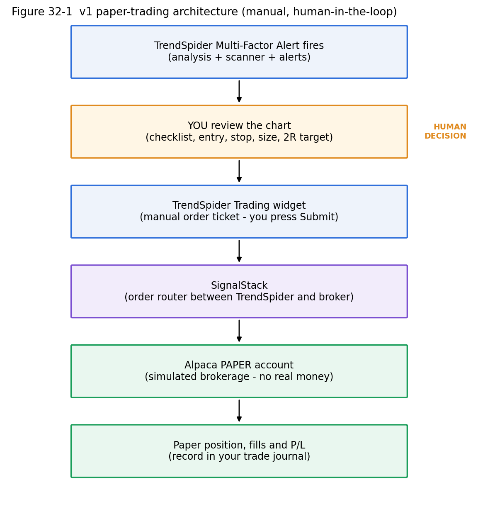
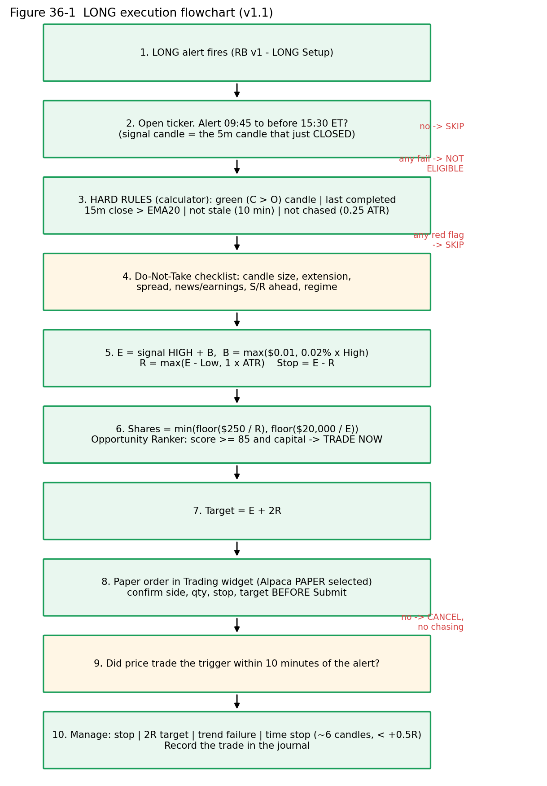
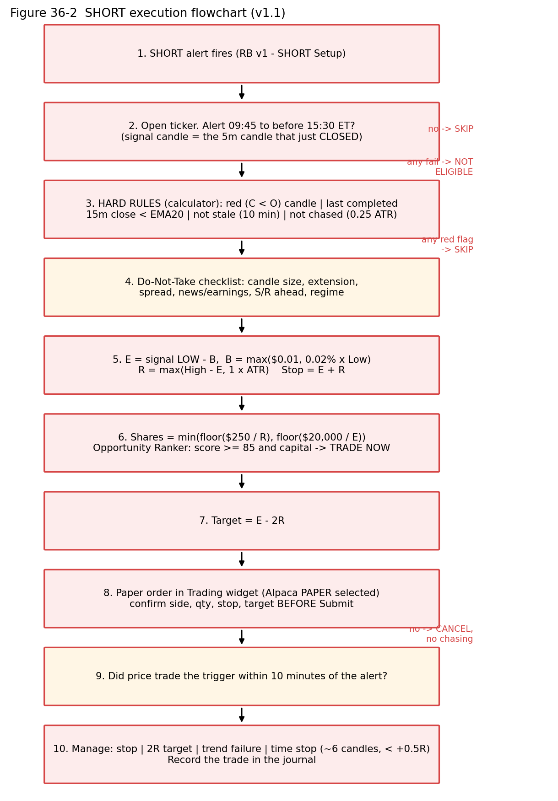

# PART VI — PAPER EXECUTION (LEVEL 6) {.unnumbered .part}

# Paper Trading Architecture

| Component | Role | What it is NOT |
|---|---|---|
| **TrendSpider** | Analysis, scanners, alerts, and a manual order ticket (Trading widget) | Not a broker. It "can not place orders in your brokerage account" by itself [TS] |
| **SignalStack** | Order **router** between TrendSpider and your broker [SS] | Not a broker. It does not hold your money |
| **Alpaca Paper** | **Simulated** brokerage account [ALP] | Not real money. Fills are simulated |

{width=75%}

::: {.rule custom-style="Box Rule"}
**NO REAL MONEY IN PAPER MODE**

In v1, every order goes to the **Alpaca PAPER** account. Paper accounts start with $100,000 of simulated money [ALP]. Before *every* order, confirm that the Trading widget shows the paper account (Chapter 35).
:::

# SignalStack

## What it does [SS]

SignalStack converts signals from charting platforms (TrendSpider, TradingView, etc.) into orders at a connected broker or exchange. TrendSpider's Trading widget uses it as the plumbing: when you press Submit in TrendSpider, SignalStack transmits the order to Alpaca. TrendSpider states that routing typically takes about **0.3 s**, and rarely up to **12 s** for some brokers [TS].

## Key concepts

| Concept | Detail |
|---|---|
| **Broker connection** | Connect Alpaca once, under **Brokers & Webhooks** [SS] |
| **Paper vs live accounts** | After connecting a broker, its accounts (live **or** paper) are fetched automatically [SS] |
| **Signal** | "A trade order successfully sent to a linked broker account". Errors don't count; "sent" ≠ "executed" [SS pricing] |
| **Quota** | Free plan: 5 signals/month with **unlimited paper signals**. Paid tiers: Basic 50, Premium 250, Pro 1,000/month. Unused signals don't roll over [SS pricing, 2026-10-28] |
| **TrendSpider allowance** | TrendSpider's pricing page lists **5 free automated trades per month** with discounted access beyond that. **VERIFY** whether manual widget orders to a paper account count against anything |
| **Webhooks** | SignalStack can receive alerts via webhook (JSON in TrendSpider's "Your Note" field) for automated trading [SS] |

## Why webhook automation is NOT part of v1

1. **The alert is not the trade.** v1 requires human confirmation: checklist, break of the signal candle, risk check.
2. **Errors scale.** A mis-built webhook alert fires orders on every symbol it's attached to.
3. **Payload complexity.** Each broker needs its own JSON format [SS], and mistakes create wrong sides or sizes.
4. **No evidence yet.** Automating an unproven system automates losses faster.

## Setup flow

::: {.ts custom-style="Box TrendSpider"}
**TRENDSPIDER + SIGNALSTACK STEP — Connect trading [TS][SS]**

1. In TrendSpider, add the **Trading Widget** to the right sidebar.
2. Click **Enable Trading** to connect SignalStack. If you have no SignalStack account, one is created for you.
3. Confirm that you allow TrendSpider to access your SignalStack account.
4. In SignalStack, choose **Alpaca** from the brokers list → **Continue** → you are redirected to Alpaca → log in → **Continue** → click **Allow** to authorise SignalStack.
5. The account appears under **Brokers & Webhooks** in SignalStack, and in the TrendSpider Trading widget, usually within a minute.
:::

::: {.warn custom-style="Box Warn"}
**VERIFY — paper vs live during Alpaca authorisation**

SignalStack's Alpaca guide does **not** describe how to choose the *paper* account during OAuth. Your current setup shows an **Alpaca Demo/Paper** account in TrendSpider. Confirm the exact label you see (e.g., "Demo", "Paper") and record it in SS-37. If you also connect a live Alpaca account later, **two** accounts may appear: always check which is selected.
:::

::: {.warn custom-style="Box Warn"}
**SECURITY**

SignalStack requests access to your **entire portfolio** to trade [SS]. That is expected. Never paste API keys or passwords into chats, notes or documents, and keep your Alpaca login protected with two-factor authentication.
:::

::: {.shot custom-style="Box Screenshot"}
**[SCREENSHOT REQUIRED — SS-34 · Trading widget "Enable Trading"]** · **[SS-35 · Alpaca "Allow" authorisation popup for SignalStack]** · **[SS-36 · SignalStack Brokers & Webhooks listing Alpaca]**
:::

# Alpaca Paper Trading

## Account terms as Alpaca shows them

| Term | Meaning in your paper account |
|---|---|
| **Paper account** | Simulated account. Default **$100,000**. Balance cannot be changed after creation; there is no reset button: you open a new paper account instead [ALP] |
| **Portfolio value / equity** | Cash + positions at current prices. **Use this number for the 0.25% calculation.** |
| **Cash** | Uninvested balance (can go negative with margin, and rises when you short) |
| **Buying power** | Maximum you're *allowed* to commit (margin-dependent). **Not** a sizing target |
| **Positions** | Current holdings with average entry, market value and unrealized P/L |
| **Orders** | Every order and its status: `new`, `partially_filled`, `filled`, `canceled`, `expired`, `rejected`, etc. [ALP] |
| **Fill** | An execution. One order can have several partial fills |
| **Realized P/L** | Closed-trade profit/loss |
| **Unrealized P/L** | Open-position mark-to-market |

## How paper fills are simulated [ALP]

| Aspect | Alpaca paper behaviour | Real market |
|---|---|---|
| Fill price | Against the best **NBBO** price when marketable | Depends on depth, queue and speed |
| Size | **Not** checked against displayed liquidity, so large orders fill fully | Large orders move the price |
| Partial fills | ~**10%** of eligible orders randomly partially fill | Common in thin names |
| Limit orders | Fill when the limit reaches the best ask (buy) or bid (sell) | You need your **queue position** to be reached |
| Market impact, information leakage, latency slippage, price improvement | **Not modelled** | Real |
| Regulatory fees, borrow fees, dividends | Not simulated (borrow fees "coming soon") | Real |
| Market data | Paper-only accounts get **IEX** data only | Live accounts may have full SIP data |

## Why paper results differ from real trading

| Factor | Effect |
|---|---|
| **Fills** | Paper limit orders fill when price merely *touches*; real ones may not |
| **Slippage** | Real stops slip more in fast moves |
| **Queue position** | Real limit orders wait behind earlier orders at the same price |
| **Liquidity / market impact** | Paper ignores how your order moves price |
| **Latency** | Real routing and exchange delays |
| **Emotion** | The largest difference. Losing real money changes behaviour: hesitation, moving stops, revenge trades |

::: {.rule custom-style="Box Rule"}
**PAPER ≠ LIVE**

Paper results are an **optimistic approximation**. A strategy that is only marginally profitable on paper is likely unprofitable live. Never treat paper returns as a forecast of live returns.
:::

::: {.shot custom-style="Box Screenshot"}
**[SCREENSHOT REQUIRED — SS-41 · Alpaca paper dashboard: ① account selector showing PAPER ② portfolio value ③ cash ④ buying power]** · **[SS-42 · Alpaca orders and positions pages]**
:::

# The TrendSpider Trading Widget

## Fields [TS]

| Field / area | What it does | v1 notes |
|---|---|---|
| **Brokerage / account selector** | "Select the brokerage that should receive the order" | **Must show Alpaca PAPER** |
| **Symbol** | Taken from the chart you have open | Confirm the ticker |
| **Order action: Buy / Sell** | Side | LONG entry = Buy; SHORT entry = Sell (see the VERIFY box) |
| **Order type: Market / Limit / Stop** | Only these three are documented | **Stop-Limit is not listed** in the widget |
| **Quantity** | Number of shares | From the calculator: MIN(floor($250 ÷ R), floor($20,000 ÷ E)) |
| **Stop Loss** (optional) | Protective exit | E − R (LONG) / E + R (SHORT), from the calculator |
| **Take Profit** (optional) | Target exit | E ± 2R, from the calculator |
| **Submit** | Sends to SignalStack → Alpaca | Read everything before clicking |
| **Open Positions** / **Pending Orders** | Holdings and working orders; hover + **X** to close/cancel | Holdings can take up to 1 minute to update |

**Documented limitations (Beta) [TS]:** stocks, OTC, ETFs and spot crypto only; **executed orders are not displayed** in the widget or on charts; some brokers don't show holdings; holdings may lag up to 1 minute. → **Always confirm fills in the Alpaca dashboard.**

::: {.warn custom-style="Box Warn"}
**VERIFY BEFORE YOUR FIRST REAL SESSION — the 1-share plumbing test**

The documentation does not confirm (a) whether a **Sell** with no position opens a **short** at Alpaca via SignalStack, (b) whether Stop Loss + Take Profit become a true Alpaca **bracket** (one cancels the other), and (c) whether a **Stop** entry can carry Stop Loss / Take Profit. Alpaca itself supports bracket orders with an entry plus a take-profit limit and a stop-loss, where exit legs activate after the entry fills and one cancels the other, during the regular session only [ALP].

**Test during market hours with 1 share of a liquid stock (paper):**

1. LONG: Buy 1, Market, Stop Loss and Take Profit set ±$1. Check Alpaca: is it one bracket order with two legs?
2. Close it from the widget (X). Check that **both** exit legs were cancelled.
3. SHORT: Sell 1 (no position), Market, with Stop Loss above and Take Profit below. Check Alpaca: is the position **−1**?
4. Stop entry: Buy-Stop 1 share $0.50 above market, with SL/TP. Was it accepted? Cancel it.
5. Record the results in the Change Log. If any test fails, use the Alpaca dashboard directly for that order type.
:::

## Worked example — LONG (IBM)

Signal candle on IBM: O $255.30, H $255.60, L $255.24, C $255.55. ATR $0.37. Equity $100,000. The calculator shows BUY STOP (Chapter 38).

| Field | Value | How you got it |
|---|---|---|
| Account | **Alpaca – PAPER** | Check! |
| Action | **Buy** | LONG |
| Order type | **Stop** @ **$255.65** (pre-placed trigger) — *or* **Market** once price trades ≥ $255.65 and the calculator's late-entry review recalculates | See the process below |
| Quantity | **78** | MIN(floor(250 ÷ 0.41) = 609, floor(20,000 ÷ 255.65) = 78) |
| Stop Loss | **$255.24** | E − R = 255.65 − 0.41 (R = structure 0.41 > ATR 0.37) |
| Take Profit | **$256.47** | 255.65 + 2 × 0.41 |

## Worked example — SHORT (NVDA)

Signal candle on NVDA: O $212.95, H $212.97, L $212.57, C $212.60. ATR $0.333.

| Field | Value |
|---|---|
| Account | **Alpaca – PAPER** |
| Action | **Sell** (short; see VERIFY) |
| Order type | **Stop** @ **$212.53** (212.57 − 0.04) — *or* **Market** once price trades ≤ $212.53, after the late-entry review |
| Quantity | **94** (MIN(floor(250 ÷ 0.44) = 568, floor(20,000 ÷ 212.53) = 94)) |
| Stop Loss | **$212.97** (E + R = 212.53 + 0.44) |
| Take Profit | **$211.65** (212.53 − 2 × 0.44) |

## Order types recap

| Type | Use in v1 |
|---|---|
| Market | Entry *after* the trigger trades (Process A); emergency exits |
| Limit | Take Profit leg |
| Stop | Pre-placed breakout entry (Process B); Stop Loss leg |
| Stop-Limit | Not in the widget; not used in v1 |

## Recommended simplest safe process for v1 paper testing [REC]

| | Process A — "Confirm then Market" | Process B — "Pre-placed Stop entry" |
|---|---|---|
| How | Watch the trigger. When price trades through it **and** is within 0.25 ATR of it (calculator: LATE ENTRY REVIEW), tick *Use current price as market entry*, then send **Market** with the **recalculated** quantity, SL and TP | Immediately after the alert, send a **Stop** entry at the trigger with SL + TP; cancel if not filled within 10 minutes of the alert (stale) |
| Pros | No stale orders; works even if Stop+bracket isn't supported | No reaction delay; the entry is mechanical |
| Cons | You must watch; slippage from reaction time | Must remember to cancel; depends on the widget supporting Stop + SL/TP |
| **v1 start** | **Use A for the first 10 trades** (simplest, fewest moving parts) | Move to B after the plumbing test passes and you're comfortable |

# Tomorrow-Morning Runbook

## Timeline

| Time (ET) | Action |
|---|---|
| **08:45–09:00** | Computer on. TrendSpider logged in. Alpaca paper dashboard open in a second tab. Check that notifications work (phone sound on, TrendSpider app logged in). |
| **09:00–09:15** | Note the market context: index futures/pre-market direction, major scheduled news (CPI, FOMC, etc.), any earnings among likely candidates. Write the account equity and today's **$ risk = 0.25% × equity** on your sheet. |
| **09:15–09:30** | Open the chart layout (5m + 15m). Verify indicator parameters. Delete yesterday's alerts/lists if not expired. Confirm the Trading widget shows **Alpaca PAPER**. Start the app (`cd calculator`, `npm run dev`) and check its Settings (equity, 0.25%, $20,000). |
| **09:30–09:45** | **Observe only.** No scans, no trades. Indicators and RVOL are distorted. Any alert before 09:45 is NOT ELIGIBLE (TOO EARLY). |
| **~09:40** | Run both scanners (Refresh). Rank. Build `RB v1 LONG <date>` and `RB v1 SHORT <date>` (≤ 10 each). |
| **09:45–09:55** | Create Multi-Factor Alerts on each list (manually or Sidekick: preview → create). Spot-check 2 alerts. The entry window is open from 09:45. |
| **09:45 to before 15:30** | Respond to alerts with the 17-step procedure below. Re-scan around **11:00** and **13:30**; update lists and alerts. |
| **15:30–15:55** | **No new entries: hard rule** (NEW ENTRY WINDOW CLOSED). Cancel unfilled entry orders. Manage/close open positions. |
| **by 15:55** | **Flat.** No overnight positions in v1. Cancel all pending orders. |
| **16:00–16:30** | End-of-day review (Chapter 44, sheet 12). Journal complete. |

## When an alert fires — the 17 steps

| # | Step | Detail |
|---|---|---|
| 1 | **Open ticker** | Click the notification or type the symbol. |
| 2 | **Verify timestamp** | Alert time 09:45 to before 15:30 ET, and the trigger not yet stale (10 minutes). |
| 3 | **Identify signal candle** | The 5m candle that **closed** at the alert time. LONG must be green (C > O), SHORT red (C < O): hard rule. |
| 4 | **Check VWAP** | LONG: close above. SHORT: close below. How far, in ATR units? |
| 5 | **Check EMA9/EMA20** | Aligned? Separation? Slope? |
| 6 | **Check RSI** | LONG 55–70 ideal; SHORT 30–45 ideal. |
| 7 | **Check RVOL** | > 1.5; not absurd (> 10 = caution). |
| 8 | **Check 15m confirmation** | Close vs EMA20 of the **last completed** 15m candle at the alert time (10:07 → 09:45–10:00). Hard rule. |
| 9 | **Check candle size / extension** | Range vs ATR; distance from VWAP; Do-Not-Take list (Part 2). |
| 10 | **Run the Trade Calculator** | Enter O H L C, ATR, price, alert time, 15m Close/EMA20. Entry E = High + B (LONG) / Low − B (SHORT), B = MAX($0.01, 0.02% × price). |
| 11 | **Stop and R** | R = MAX(structural risk, 1 × ATR). Stop = E − R (LONG) / E + R (SHORT). |
| 12 | **Eligibility** | BUY STOP / SELL STOP (or LATE ENTRY REVIEW) only. Any NOT ELIGIBLE → skip. |
| 13 | **Quantity** | MIN(floor($250 ÷ R), floor($20,000 ÷ E)), from the calculator. |
| 14 | **Opportunity Ranker** | Send to Ranker. Trade only **TRADE NOW** (score ≥ 85 and capital allocated). Target = E ± 2R. |
| 15 | **Enter PAPER order** | Process A or B; read the account, side, qty, SL and TP aloud before Submit. Set the ranker status to Pending / Filled. |
| 16 | **Record trade** | Journal row + "before" screenshot. |
| 17 | **Monitor exits** | Stop / 2R / trend failure at each 5m close / time stop at ~30 min. |

{width=70%}

{width=70%}

# Rapid Execution Cheat Sheet and Position-Size Table

## LONG

```
Alert → Calculator hard rules → E = HIGH + B → R = MAX(E − LOW, 1×ATR)
      → Stop = E − R → Target = E + 2R → Qty → Ranker ≥ 85 → Submit

B      = MAX($0.01, 0.0002 × High)          (rounded to the cent)
R      = MAX(E − Low, 1.0 × ATR)            (rounded UP to the cent if ATR controls)
Qty    = MIN( floor($R / R), floor($20,000 / E) )
Target = E + 2R
```

## SHORT

```
Alert → Calculator hard rules → E = LOW − B → R = MAX(HIGH − E, 1×ATR)
      → Stop = E + R → Target = E − 2R → Qty → Ranker ≥ 85 → Submit

B      = MAX($0.01, 0.0002 × Low)
R      = MAX(High − E, 1.0 × ATR)
Qty    = MIN( floor($R / R), floor($20,000 / E) )
Target = E − 2R
```

Where $R = 0.25% × current equity ($250 at $100,000) and $20,000 is the per-ticker investment cap.

**Hard rules (any fail = NOT ELIGIBLE):** LONG C > O / SHORT C < O · 09:45 ≤ time < 15:30 ET · last completed 15m Close vs EMA20 (LONG above, SHORT below) · not stale (10 min) · not chased (> 0.25 ATR past E) · price not through the stop · no position or order in the ticker.

## Position-size table ($100,000 account, $250 risk, $20,000 cap)

| R (risk/share) | Shares by risk = floor(250 ÷ R) | Max entry price before the $20k cap binds* |
|---|---|---|
| $0.10 | **2,500** | $8.00 |
| $0.20 | **1,250** | $16.00 |
| $0.25 | **1,000** | $20.00 |
| $0.50 | **500** | $40.00 |
| $0.75 | **333** | $60.06 |
| $1.00 | **250** | $80.00 |
| $1.50 | **166** | $120.48 |
| $2.00 | **125** | $160.00 |
| $2.50 | **100** | $200.00 |
| $5.00 | **50** | $400.00 |

\*If the entry price is above this value, the cap binds: use floor($20,000 ÷ E) instead (table below).

## Shares at the $20,000 cap

| Entry E | floor(20,000 ÷ E) | | Entry E | floor(20,000 ÷ E) |
|---|---|---|---|---|
| $20 | 1,000 | | $200 | 100 |
| $50 | 400 | | $212.53 (NVDA) | **94** |
| $100 | 200 | | $255.65 (IBM) | **78** |
| $150 | 133 | | $300 | 66 |
| $175 | 114 | | $500 | 40 |

**Always round DOWN.** 250 ÷ 0.75 = 333.33 → **333**, not 334. 20,000 ÷ 255.65 = 78.23 → **78**. Rounding up risks more than your limit, and many tiny overshoots add up.

# Using the App — Trade Calculator and Opportunity Ranker

The **RB v1 Trade Execution Calculator + Opportunity Ranker** is a local web app (folder `calculator/`) that implements the RB v1.1 rules in this manual exactly. It answers two separate questions:

1. **Trade Calculator:** is this TrendSpider alert *eligible to trade*, and what are the exact order numbers?
2. **Opportunity Ranker:** among eligible setups, which deserve your limited capital?

::: {.rule custom-style="Box Rule"}
**WHAT THE APP NEVER DOES**

It does not predict direction, it never claims a high score will win, and it **never sends orders** to Alpaca, SignalStack, TrendSpider or any broker. You still place every paper order yourself in the Trading widget (Chapter 35).
:::

::: {.why custom-style="Box Why"}
**WHY IT MATTERS — "calculable" is not "eligible"**

A setup can have a perfectly valid entry, stop, target and quantity and still be **NOT ELIGIBLE** because of time, candle direction, the 15m trend, staleness, chasing or portfolio rules. When in doubt the app says **DO NOT TRADE**: during paper testing a missed trade (false negative) is preferred to a bad one (false positive).
:::

## Starting the app

Requires Node.js 20 or later. The first time, install the packages; after that only the second command is needed.

```
cd calculator
npm install
npm run dev          # then open http://localhost:5173
```

`npm test` runs the unit tests. The journal, settings, ranker queue and positions are stored in your browser (localStorage), so use **Journal → Backup JSON** regularly. The tabs are **Calculator · Opportunity Ranker · Journal · Dashboard · Settings**.

## The Trade Calculator

### Inputs

| Input | Where it comes from |
|---|---|
| Direction (LONG / SHORT) | The alert name. Never inferred from the chart |
| Signal candle **O H L C** | The completed 5m candle that fired the alert |
| **ATR(14)**, 5-minute | The ATR indicator on the 5m chart |
| Current price | Last trade |
| Alert time (ET, 24h) | The alert notification; the **Now** button fills the current time |
| Last completed 15m Close and 15m EMA20 | The 15m chart: the candle shown by the app (Chapter 13 rule) |
| Investment cap ($20,000), equity ($100,000), risk % (0.25%) | Defaults from Settings |
| Minutes since alert (optional) | Used for the stale rule and the time window |
| Existing position in the ticker | Your Open Positions / Pending Orders |

### Outputs

The calculator shows B, E, structural risk, ATR risk, **R** (and which one controlled), stop, target, shares by risk, shares by cap, final shares, position value, planned loss, potential profit and Reward:Risk 2.00. **Show Calculation** prints every step with the numbers substituted.

### Status

| Status | Meaning | Action |
|---|---|---|
| **BUY STOP / SELL STOP** | Every hard rule passed; price has not reached E | Place the stop entry with the ticket's stop and target, or wait for Process A |
| **MARKET — LATE ENTRY REVIEW** | Trigger crossed by ≤ 0.25 ATR | Tick *Use current price as market entry* only if you accept the recalculated stop, target and shares |
| **NOT ELIGIBLE — …** | A hard rule failed; every reason is listed, highest priority first | Do not trade. The greyed ticket says INVALID — DO NOT PLACE; Copy, Save and Send to Ranker are disabled |
| **INVALID INPUT** | A required input is missing or nonsensical | Fix the input |
| **DO NOT ADD / MANAGE EXISTING TRADE FIRST** | You already hold a position or order in the ticker | Manage the existing trade |

### Worked example — IBM LONG (alert 10:07 ET)

Inputs: O 255.30 · H 255.60 · L 255.24 · C 255.55 · ATR 0.37 · price 255.50 · last completed 15m candle (09:45–10:00) Close 255.48, EMA20 255.00.

| Step | Calculation | Result |
|---|---|---|
| Hard rules | C > O ✓ · 10:07 in window ✓ · 255.48 > 255.00 ✓ · not crossed, not stale ✓ | Eligible |
| Buffer | MAX(0.01, 0.0002 × 255.60 = 0.05112) | **$0.05** |
| Entry | 255.60 + 0.05 | **$255.65** |
| R | MAX(255.65 − 255.24 = 0.41, 0.37) | **$0.41** (structure) |
| Stop / Target | 255.65 − 0.41 / 255.65 + 0.82 | **$255.24 / $256.47** |
| Shares | MIN(floor(250 ÷ 0.41) = 609, floor(20,000 ÷ 255.65) = 78) | **78** (cap) |
| Value / loss / profit | 78 × 255.65 / 78 × 0.41 / 78 × 0.82 | $19,940.70 / **$31.98** / $63.96 |
| Status | price 255.50 < 255.65 | **BUY STOP @ 255.65** |

### Worked example — NVDA SHORT

Inputs: O 212.95 · H 212.97 · L 212.57 · C 212.60 · ATR 0.333 · price 212.70 · last completed 15m Close 212.65, EMA20 213.30.

| Step | Calculation | Result |
|---|---|---|
| Hard rules | C < O ✓ · in window ✓ · 212.65 < 213.30 ✓ | Eligible |
| Buffer | MAX(0.01, 0.0002 × 212.57 = 0.042514) | **$0.04** |
| Entry | 212.57 − 0.04 | **$212.53** |
| R | MAX(212.97 − 212.53 = 0.44, 0.333) | **$0.44** (structure) |
| Stop / Target | 212.53 + 0.44 / 212.53 − 0.88 | **$212.97 / $211.65** |
| Shares | MIN(floor(250 ÷ 0.44) = 568, floor(20,000 ÷ 212.53) = 94) | **94** (cap) |
| Value / loss / profit | | $19,977.82 / **$41.36** / $82.72 |
| Status | price 212.70 > 212.53 | **SELL STOP @ 212.53** |

The same NVDA inputs with the alert at 16:04 → AFTER REGULAR SESSION; at 15:31 → NEW ENTRY WINDOW CLOSED; at 09:40 → TOO EARLY. The numbers are unchanged, but the setup is NOT ELIGIBLE.

## The Opportunity Ranker

Click **Send to Opportunity Ranker** on an eligible calculator result, then add the ranker inputs (RVOL, RSI, VWAP, EMA9, EMA20 and sector, plus optional industry/theme). The ranker decides in this fixed order:

1. **Strategy hard rules** (the same rules as the calculator, re-checked). Any failure → **NOT ELIGIBLE — CANNOT BE RANKED**. The candidate is not scored.
2. **Required inputs.** Anything missing → **SCORING INCOMPLETE** with the missing fields listed. Missing values are never treated as 0.
3. **Score** = Setup Quality (max 70) + Portfolio Fit (max 30), total ≤ 100.
4. **Portfolio hard rules** → BLOCKED — NO POSITION SLOT / CAPITAL / PORTFOLIO HEAT / CORRELATED EXPOSURE.
5. **Absolute threshold** (below), applied before any relative ranking.
6. **Capital allocation**, highest score first.

### The 100-point score

All distances are in 5-minute ATRs. SHORT mirrors LONG.

| Component | Max | What earns points |
|---|---|---|
| Trend | 15 | EMA9–EMA20 separation, price vs EMA20, 15m Close vs 15m EMA20 |
| RVOL | 15 | < 1.5: 0 · 1.5: 6 · 2.0: 9 · 2.5: 12 · ≥ 3.5: 15 |
| Momentum (RSI) | 10 | LONG 55–60: 6 · 60–65: 9 · 65–70: 10 · 70–75: 7 · ≥ 75: 4 (SHORT uses 100 − RSI) |
| Candle | 10 | Body ÷ range and close location; a large opposing wick scores 2 |
| Location | 10 | Extension from VWAP / EMA20 (less is better); penalty if price is already past the entry |
| Time | 10 | 09:45–11:30: 10 · 11:30–14:00: 6 · 14:00–15:30: 8 (outside the window = hard fail, no score) |
| Capital efficiency | 10 | Reward ÷ position value, relative to ≥ 3 peers (otherwise neutral 6) |
| Capital availability | 8 | Share of the remaining allocatable capital the trade needs |
| Diversification | 7 | No overlap 7 · same sector 4 · same industry/theme 1 · blocked 0 |
| Portfolio risk | 5 | Projected heat ÷ limit (lower is better) |

### Thresholds

| Score | Tier | Recommendation |
|---|---|---|
| **90–100** | ELITE — preferred capital allocation | **TRADE NOW — ELITE** (if capital is allocated) |
| **85–89** | HIGH PRIORITY — trade consideration | **TRADE NOW — HIGH PRIORITY** (if capital is allocated) |
| 80–84 | WATCHLIST / RESERVE | Not a trade candidate |
| 75–79 | LOW PRIORITY | Normally skip |
| < 75 | SKIP — QUALITY BELOW THRESHOLD | — |

::: {.rule custom-style="Box Rule"}
**MY v1.1 RULE — 85 is the minimum score to trade**

Trade only a candidate that shows **TRADE NOW**. That requires: no hard-rule failure · score **≥ 85** · capital allocated · a free slot · heat within limit · correlation satisfied · entry still valid · no better candidate takes the slot. **Rank** ("#1 of 3") is shown separately from eligibility: a #1 rank never makes a below-threshold setup tradeable.
:::

### Capital allocation and portfolio policy

| Setting | Default |
|---|---|
| Account equity | $100,000 |
| Liquidity reserve | 20% → **allocatable $80,000** |
| Max position | $20,000 per ticker |
| Max positions | **4** (open + pending) |
| Risk per trade | 0.25% ($250) |
| Portfolio heat | **1%** ($1,000) of planned risk, open + pending |
| Correlation | Max 1 highly correlated same-direction position per sector/industry/theme |
| Replacement advantage | 5 points |

Candidates scoring ≥ 85 are allocated **best score first**, never in arrival order. Each one uses up capital, a slot and heat, and counts as correlated exposure for the candidates below it. A qualifying candidate that does not fit shows **CAPITAL WAITLIST** (or BLOCKED — CORRELATED EXPOSURE). Broker buying power is never the budget, and a **pending** stop order reserves its capital so the same dollars cannot be allocated twice.

### Pending-order replacement — filled positions are never displaced

If a **pending** (unfilled) order holds capital and a new candidate scoring ≥ 85 beats it by **≥ 5 points** (re-scored as if the pending capital were released), the ranker shows **STRONGER OPPORTUNITY AVAILABLE** with **KEEP** or **CANCEL & RESERVE**. Nothing happens automatically: you decide, and you cancel the old order in the Trading widget yourself. A **filled** position is never displaced; its stop and target govern it.

### Lifecycle and audit snapshots

Move each candidate through its statuses as you act: New → Watchlist → **Pending** (stop order placed, capital reserved) → **Filled** (capital deployed) → Stopped out / Target hit / Manual exit, or Skipped / Stale / Canceled / Expired. Every candidate stores frozen **snapshots**: *initial* (first complete scoring), *entry* (when Filled) and *final* (terminal status). Each snapshot records the rules and scoring version (**RB v1.1**), the settings, every hard-rule result, the components, total, tier, decision and timestamp. Later rule or weight changes never rewrite old decisions, which is what makes the ranker analytics honest.

## A complete alert, step by step

1. Alert fires → open the 5m and 15m charts.
2. Calculator: enter direction, O H L C, ATR, price, alert time, the last completed 15m Close and EMA20, minutes since alert.
3. NOT ELIGIBLE → skip and (optionally) save the reason in the journal. Eligible → read the ticket.
4. **Send to Opportunity Ranker**, add RVOL, RSI, VWAP, EMA9, EMA20, sector.
5. TRADE NOW → place the paper order in the Trading widget with the calculator's numbers (Chapter 35); set the candidate to **Pending**, then **Filled** when it triggers. Anything else → do not trade.
6. Exit → set the final status; record the trade in the journal (Chapter 39).

::: {.warn custom-style="Box Warn"}
**THE SCORES ARE HYPOTHESES**

Every RB v1.1 number in the app is a paper-testing assumption, not a proven edge: the 0.02% / $0.01 buffer, the 1 ATR minimum stop, the 2R target, the 0.25 ATR chase limit, the 10-minute stale window, the 09:45–15:30 window, the 15m EMA20 hard rule, every scoring weight and band, the thresholds 90/85/80/75, the 5-point replacement advantage and the portfolio policy. Use the journal and the ranker analytics to test them after 50–100 trades, and record any change as a new version (v1.2, v2.0) in the Change Log.
:::

::: {.shot custom-style="Box Screenshot"}
**[SCREENSHOT REQUIRED — SS-43 · Trade Calculator with the IBM example: ① inputs ② decision panel ③ order ticket ④ Show Calculation]** · **[SS-44 · Opportunity Ranker: ① candidate table with score, tier and rank ② score card ③ capital/heat summary ④ STRONGER OPPORTUNITY prompt]**
:::
